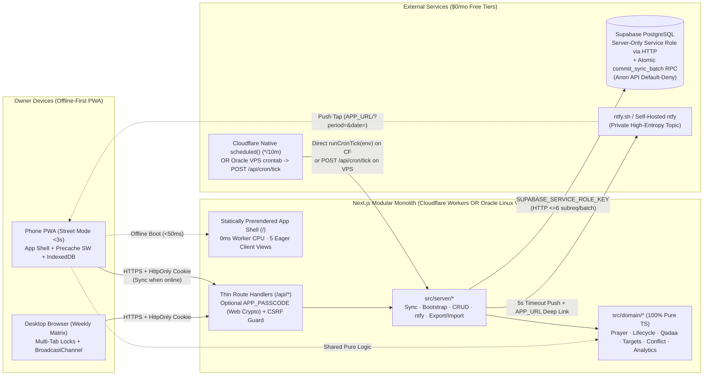

# Stage 4: System Architecture & Design — Mohasba Tracker v2

**Status:** **GATE 4 APPROVED (2026-11-21)** — Transitioned to Stage 5 (Data, Interfaces & Security)  
**Governance Mode:** Strict (Architecture & ADRs only; Stage 5 covers SQL DDL, RPC & API contracts; zero production code until Stage 7)  
**Architecture Style:** **Right-Sized Personal Open-Source Modular Monolith** (Next.js App Router + Server-Only Supabase Postgres + Offline-First Client PWA)  
**Last Updated:** 2026-11-21  
**Upstream References:**
- [docs/00-discovery-qa.md](file:///d:/Ahmed/Projects/mohasba/docs/00-discovery-qa.md) *(Gate 1 Approved)*
- [docs/01-requirements.md](file:///d:/Ahmed/Projects/mohasba/docs/01-requirements.md) *(Gate 2 Approved — see Section 8 for bounded §7.1 simplification)*
- [docs/02-ux-design-system.md](file:///d:/Ahmed/Projects/mohasba/docs/02-ux-design-system.md) *(Gate 3 Approved)*

---

## 1. Architectural Philosophy & Design Constraints

This system is a **personal, single-instance, open-source accountability application**: one owner deploys one private web app connected to their own Supabase Postgres database (free tier), used daily from **Phone (offline-capable PWA in the street)** and **PC (desktop weekly ledger)**.

### Guiding Principles
1. **Moderate & Right-Sized:** Zero microservices, zero Redis/Kafka/queues, zero sync SaaS lock-in (no ElectricSQL / PowerSync / RxDB), zero multi-tenancy, zero user-account / OAuth / RBAC / Supabase Auth ceremony.
2. **Hard Problems Solved Properly:** Put real engineering rigor strictly on the **4 things that actually fail in daily life**:
   - `<3s` offline street logging + 5-second Undo + ACID Phone-vs-PC conflict convergence,
   - Zero-API deterministic Islamic prayer windows & Fajr-to-Fajr rollover across DST/timezones,
   - Single-instance privacy without auth bloat, CSRF holes, shared-device leaks, or offline lockout bugs,
   - Zero-cost `$0/month` deployment with **Oracle / Linux VPS Docker (`output: 'standalone'`) + Cloudflare Tunnel** as the **Primary Launch Target** (zero serverless CPU/subrequest caps, native `crontab` + automated weekly backups) and **Cloudflare Workers (`@opennextjs/cloudflare`)** as a first-class **Supported Open-Source Target** — both running native 10-minute `ntfy` reminders that continuously keep Supabase Free Tier alive (well inside its 7-day inactivity pause).
3. **Pure Portable Domain Core & Runtime Neutrality:** Keep 100% of business logic inside framework-agnostic TypeScript (`src/domain/*`) and use Web Standard server APIs (`Web Crypto` `crypto.subtle`, standard `fetch`-based `@supabase/supabase-js`) so the exact same codebase runs cleanly on **Cloudflare Workers (`workerd` + `nodejs_compat`)** AND **Oracle / Linux VPS (Node 20 Docker)** with zero rewrite.

---

## 2. High-Level System Topology



### Runtime Boundary Rules
- **Browser never talks to Supabase directly:** Zero `NEXT_PUBLIC_SUPABASE_*` keys, zero browser PostgREST calls, zero JWT refresh cycles. Every server data access flows through Next.js Route Handlers (or direct Cloudflare `scheduled()` invocation) using server-only `SUPABASE_SERVICE_ROLE_KEY`, while Supabase's public `anon`/`authenticated` PostgREST roles stay locked down (RLS enabled with zero permissive policies = default-deny).
- **Secrets Strictly in Environment Variables:** `SUPABASE_SERVICE_ROLE_KEY`, `APP_PASSCODE`, `CRON_SECRET`, and `NTFY_TOPIC_URL` live **exclusively** in runtime env vars / Worker secrets — **never** persisted in Postgres `app_settings` — so JSON exports and future `v1.1+` agent reads can never leak secrets.
- **Zero External Prayer APIs:** Prayer times and Fajr-to-Fajr rollover run deterministically in both Browser and Server Cron via the exact same pure TypeScript module (`src/domain/prayer-engine.ts` + `adhan`).

---

## 3. Modular Monolith Structure & Dependency Boundaries

Strict **one-way dependency graph** (enforced via ESLint `no-restricted-imports`):

```text
src/app/*  ──►  src/client/* (UI/PWA)   ──►  src/domain/* (100% Pure TS)
           ──►  src/server/* (API/Cron) ──►  src/domain/* (100% Pure TS)
```

- `src/domain/*` **MUST NOT** import `react`, `next/*`, `@supabase/*`, DOM APIs (`window`, `indexedDB`), or Node-only APIs (`fs`, `crypto`).
- `src/client/*` **MUST NOT** import `src/server/*` (enforced via ESLint `no-restricted-imports`).
- **Cloudflare `wrangler` Bundling Rule:** Keep core `src/server/services/*` and `src/server/db/*` **free of `import 'server-only'`** (because `wrangler`'s esbuild bundle for `custom-worker.ts` `scheduled()` does not set Next.js's `react-server` export condition and would throw!). Accept an explicit `RuntimeConfig` object (`{ supabaseUrl, serviceRoleKey, appUrl, ntfyTopicUrl, ... }`) rather than reading `process.env` deep inside services.

| Layer | Modules & Exact Responsibilities |
| :--- | :--- |
| **`src/domain/*`** *(Shared Pure Core)* | • `types.ts` — Canonical enums & domain types (`RolloverMode`, `CanonicalLogState`, `PeriodSide`, `TargetVersion`, `SyncMutation`).<br>• `prayer-engine.ts` — `adhan` wrapper (`new Date(y, m - 1, d, 12, 0, 0)`), two-pass `zonedWallClockToUtc(isoDate, hhmm, ianaTimezone)` DST helper, 3-day sliding window `{ C - 1, C, C + 1 }`, `FAJR` vs `MIDNIGHT` rollover, active window selector, and Horizon Rail elapsed ratio + 25m pre-expiry flag.<br>• `lifecycle.ts` — Two-layer availability (`explicit_cell_override ?? !default_disabled_days`), 5-state canonicalization (`100%→DONE`, `0%→MISSED`, forbidden transition guards), and non-overwriting bulk planners (`تم ما في المسجد`, `تم الفترة بالكامل`, `يوم اعتيادي`, `ترحيل للقضاء`).<br>• `qadaa.ts` — Global cross-week Qadaa queue (`<= today`), non-recoverable filtering, historical repair attribution, and original `target_version_id` preservation.<br>• `targets.ts` — Simple Rename vs Target Evolution (`effective_from` default `D` if empty else `D+1`, referenced-version immutability check, active target resolver).<br>• `conflict.ts` — Deterministic conflict resolver (`base_row_version` integer fast-path, `Positive/Intentional > MISSED`, `Positive vs Positive` newer `client_updated_at`, independent `note_updated_at` LWW, `client_target_version_id` retention, soft-archive check). Shared by `POST /api/sync` AND JSON Import.<br>• `analytics.ts` — Computes all 3 Lean Insights (Weakest Spots `<85%` + cold-start + 7d/5-log `"هدف جديد"` guard + inline progression trail; `7d/30d` isolated `TIME_BOUND` vs `DAILY_GROUP` with Core Jamaah separated from Sunan; Qadaa/Backlog/Core-Miss Pulse).<br>• `starter-pack.ts` + `templates.ts` + `i18n/ar.ts` — Legacy Starter Pack, 3-level Islamic accountability templates (`level_1` / `level_2` / `level_3`) + pure customizer, & semantic Arabic dictionary. |
| **`src/server/*`** *(Server-Only, Config-Injected)* | • `db/supabase.ts` — Factory taking `RuntimeConfig` (`SUPABASE_SERVICE_ROLE_KEY` over HTTP `fetch`).<br>• `repositories/*` — Typed DB accessors (`settings`, `schema`, `logs`, `syncBatchRpc`, `authLockout`, `dispatches`).<br>• `services/bootstrap-service.ts` — Builds initial/delta snapshot (`settings`, `periods`, `actions`, `target_versions`, 90d logs + all open Qadaa rows, `server_now`) + idempotent `initStarterPack` (`actions === 0`).<br>• `services/sync-service.ts` — Batched `POST /api/sync` processor (`<= 50` mutations/req; 2–4 bulk reads → pure `domain/conflict.ts` → **1 atomic Postgres RPC `commit_sync_batch`** guarded by `row_version`, single retry on ~5ms race; `<= 6` total subrequests).<br>• `services/crud-service.ts` — Online-only Settings, Period/Action CRUD, soft-archive, smart 2-tier permanent delete (`deletePeriod`/`deleteAction` with `409 HAS_CHILDREN`/`HAS_HISTORY` guards & `?force=true` cascade), and Target Version append.<br>• `services/export-import-service.ts` — Complete all-time online JSON Export (`GET /api/export`) + chunked (`<= 200` logs/req) idempotent merge JSON Import (`target_versions` before `daily_logs`, merged via `domain/conflict.ts`).<br>• `services/ntfy-dispatcher.ts` — `runCronTick(config)`: piggybacks Supabase keep-alive, evaluates 3-day prayer windows, enforces `triggerInstant <= now < endInstant` anti-flood bound, claims dispatch slot atomically, dispatches via `Promise.allSettled` (`5s` timeout + `APP_URL` deep link), and prunes `applied_mutations > 90d` once daily.<br>• `access/guard.ts` — Web Crypto (`crypto.subtle`) HKDF/PBKDF2-derived HMAC cookie check + 1-row Postgres unlock lockout + `Origin`/`Sec-Fetch-Site` CSRF guard + constant-time `CRON_SECRET` verifier. |
| **`src/client/*`** *(Browser PWA)* | • `db/idb.ts` — Thin `idb` (~1.2KB) wrapper over 4 IndexedDB stores (`snapshot`, `logs`, `outbox`, `meta`) + full-wipe helper for Sign Out.<br>• `sync/outbox-engine.ts` — `<50ms` atomic IDB write, 5s Undo timer (`hold_until` persisted durably in IDB — no brittle `pagehide` `keepalive` network race), strict mutation immutability once dispatched, stale-ACK protection, cross-tab `navigator.locks` + `BroadcastChannel('mohasba-sync')`, **Drain-Before-CRUD** gate, exponential backoff, 4-state Sync Badge.<br>• `store/mohasba-provider.tsx` — Hydrates from IDB immediately on mount, runs `src/domain/*` via `useMemo`, protects dirty `outbox` cells during `/api/bootstrap` reconciliation, lazy-loads `>90d` weeks via `GET /api/logs?from=&to=`.<br>• `pwa/register-sw.ts` — Atomic build-manifest Service Worker lifecycle (safe non-interrupting updates), iOS `!standalone` A2HS prompt, `navigator.storage.persist()`. |
| **`src/app/*`** *(Thin UI & Routes)* | • `layout.tsx` & `page.tsx` — **Statically prerendered (`0 ms` Worker CPU)** RTL root (`dir="rtl" lang="ar"`), self-hosted `Readex Pro` (`next/font`), anti-FOUC inline theme script, PWA manifest/icons, mounting the **Single Cached App Shell** with all 5 views **eagerly bundled** (no `next/dynamic` on offline views) + inline Unlock/Sign-Out controls. Zero dynamic `cookies()`/`headers()`/`searchParams` server reads in page/layout.<br>• `api/*` — Thin `force-dynamic` Route Handlers: `POST /api/unlock`, `POST /api/logout`, `GET /api/bootstrap`, `POST /api/bootstrap/init`, `POST /api/sync`, `GET /api/logs`, `GET /api/export`, `POST /api/import`, `POST/PATCH /api/settings/*`, `POST /api/cron/tick` (**`POST`-only**). |

---

## 4. Offline-First PWA & Sync Architecture

### 4.1 Single Cached App Shell + Build-Manifest `public/sw.js` (ADR-01 & ADR-02)
- **Avoids Next.js App Router `.rsc` Offline Failures:** Rendering all 5 screens inside one statically prerendered App Shell at `/` (`?view=now|week|qadaa|analytics|settings`, read client-side) gives **`0ms` offline tab switching**, burns **`0 ms` Cloudflare Worker CPU** on shell loads, works seamlessly for `ntfy` deep links (`/?period=<id>&date=<D>`), and means the Service Worker caches **only one HTML shell**.
- **Zero `ChunkLoadError` & Zero Half-Updated Deploys (`public/sw.js` ~120 lines + ~15-line post-build manifest):**
  - **Eager Offline Bundling:** All 5 core screens and cell/Qadaa modals are eagerly bundled inside the `/` App Shell (no `next/dynamic` lazy chunks on offline flows).
  - **Atomic Precache Manifest:** A tiny ~15-line post-build script writes `public/sw-manifest.json` listing `/`, all `/_next/static/*` JS/CSS chunks, self-hosted `Readex Pro` `.woff2` fonts (`/_next/static/media/*`), and icons tagged with `buildId`. On `install`, `public/sw.js` atomically runs `cache.addAll()` into `mohasba-shell-<buildId>` — if street 4G drops mid-download, `install` aborts and the previous build stays **100% intact**.
  - **Strict SW Cache Rules:**
    - `public/sw.js` itself is served with `Cache-Control: no-cache, no-store, must-revalidate`.
    - `/api/*`, `RSC: 1`, and `?_rsc=` → **Strictly `NetworkOnly`** (data durability lives in IndexedDB, never HTTP cache).
    - Precached shell & `/_next/static/*` → **`CacheFirst`** from the active atomic build cache (matched by pathname `/` ignoring query params for offline `ntfy` deep links).
    - **Redirect-Loop Immunity:** SW never caches non-200 or redirected responses; `/api/*` returns `401` JSON (never `302` redirects).
    - **Safe Deploy Updates:** New SW waits in `waiting` state and activates only when `heldUndoCount === 0 && !isSyncing` (or on user click of a quiet `"تحديث متاح"` chip / next cold open), then deletes old `mohasba-shell-*` caches.

### 4.2 IndexedDB Layout (`idb`, 4 Minimal Stores) & Multi-Tab Coordination
| Store | Key / Indexes | Purpose |
| :--- | :--- | :--- |
| **`snapshot`** | `key` (`settings \| periods \| actions \| target_versions`) | Lightweight config + target-version history refreshed from `/api/bootstrap` |
| **`logs`** | `cell_key` (`"${action_id}::${log_date}"`), idx `by_log_date` | O(1) `<5ms` per-cell read/write (`status`, `percent_value`, `is_disabled`, `note`, `qadaa_resolved_at`, `target_version_id`, `row_version`, `client_updated_at`, `note_updated_at`) |
| **`outbox`** | `mutation_id` (UUIDv4), idx `by_cell_key`, `by_state`, `by_created_at` | Durable pending queue (`held \| pending \| in_flight \| attention_needed`), `batch_id`, `attempt_count`, `parent_mutation_id`, `undo_prior_snapshot`, `base_row_version`, `client_updated_at`, `note_updated_at`, `client_target_version_id` |
| **`meta`** | `key` | `device_id`, `last_synced_at`, `schema_version` |

- **Multi-Tab PC Safety (~25 LOC, zero deps):** Coordinate `outbox` drains across open desktop tabs via browser-native **`navigator.locks.request('mohasba-outbox-drain', { ifAvailable: true })`** (with in-memory fallback) and propagate IDB writes/bootstrap refreshes to sibling tabs via **`BroadcastChannel('mohasba-sync')`**.

### 4.3 Street Tap (`<50ms`), 5-Second Undo & Durable IDB-First Sync Flow

```mermaid
sequenceDiagram
  actor User
  participant UI as Street UI (<50ms)
  participant IDB as IndexedDB (logs + outbox)
  participant API as POST /api/sync
  participant DB as Supabase Postgres (RPC)

  User->>UI: Tap ✅ or "تم ما في المسجد"
  UI->>IDB: Atomic IDB Tx: update logs[cell_key] + enqueue outbox(held, hold_until=now+5s, attempt_count=0)
  IDB-->>UI: Committed (<50ms)
  UI-->>User: Optimistic green + 5s Undo Toast

  alt User taps Undo within 5s
    User->>UI: Tap "تراجع"
    UI->>IDB: Atomic IDB Tx: restore undo_prior_snapshot + delete never-sent held rows
    Note over UI,DB: Zero network traffic sent
  else App closes / backgrounds before 5s
    Note over UI,IDB: Row is ALREADY durable in IDB with hold_until timestamp (zero brittle pagehide keepalive race!)
    Note over UI,IDB: On next foreground/online open (now >= hold_until), promotes held -> pending & drains cleanly
  else 5s timer expires normally
    UI->>IDB: Promote held -> pending
    opt Online (under navigator.locks)
      UI->>IDB: Mark attempt_count += 1 (mutation_id & payload FROZEN forever)
      UI->>API: POST /api/sync (<=50 mutations, 10s timeout)
      API->>DB: 2-4 Bulk Reads -> domain/conflict.ts -> 1 Atomic RPC (commit_sync_batch)
      DB-->>API: Resolved rows (new row_version) + explicit ACK + server_now
      API-->>UI: 200 OK { results }
      UI->>IDB: Remove acked M1; apply resolved_row ONLY if no newer M2 exists for cell_key + BroadcastChannel
    end
  end
```

### 4.4 ACID Sync Protocol, Strict Mutation Immutability, `row_version` & Drain-Before-CRUD (`POST /api/sync`)
1. **Strict Mutation Immutability & Safe Local Coalescing (Zero Lost-Edit Guarantee):**
   - **Coalesce ONLY while purely local (`attempt_count === 0`):** Rapid offline taps on the same `(action_id, log_date)` may merge into an existing `held` or never-dispatched `pending` row (preserving original `base_row_version` and `undo_prior_snapshot`).
   - **Freeze Forever Upon First Dispatch (`attempt_count >= 1`) + Causal Parent Chaining:** The instant a mutation is picked up for network dispatch—even if the network drops before receiving an ACK—its `mutation_id` and payload are **strictly immutable**. Any subsequent user edit on the same cell **MUST allocate a brand-new `mutation_id` (`M2`)** and attach **`parent_mutation_id = M1`** (plus `device_id`), preventing both duplicate suppression AND false self-conflict rejection.
   - **Stale-ACK Protection:** When an ACK (`applied` or `already_applied`) returns for `M1` with `resolved_row`, the client deletes `M1` from `outbox` and updates `logs[cell_key]` **ONLY if no newer un-ACKed mutation (`M2`) exists in `outbox` for that `cell_key`** (if `M2` exists, only `M2`'s `base_row_version` is updated while preserving the newer optimistic UI state).
   - **No Brittle `pagehide` `keepalive` Racing:** Because taps commit durably to IndexedDB in `<50ms` with a persisted `hold_until` timestamp, closing the app inside the 5s Undo window does **not** risk unreliable fire-and-forget `keepalive` sends; the next foreground/online wake promotes any expired `hold_until` row to `pending` and flushes cleanly with full ACK handling.
2. **Batched Read + Pure TS Conflict + Single Atomic Postgres RPC (`<= 6` Subrequests/Batch):**
   - Client chunks flushes at **`<= 50` mutations/request** (respecting Cloudflare Workers Free Tier's `50`-subrequest limit).
   - Server performs **2–4 bulk reads** (`applied_mutations`, `actions`, `target_versions`, current `daily_logs` for touched `(action_id, log_date)` pairs), runs pure `src/domain/conflict.ts` in TypeScript, then commits **all resolved rows + `applied_mutations` inserts in ONE atomic Postgres RPC (`commit_sync_batch`)** guarded by `row_version` (if any single row raced in the ~5ms gap, re-read and re-resolve that row once).
   - **Explicit `already_applied` ACK Contract:** When `M1` already exists in `applied_mutations`, `POST /api/sync` returns `{ mutation_id: M1, outcome: 'already_applied', resolved_row: <current server row> }` so the client cleanly clears `M1` from `outbox` and reconciles `row_version` deterministically.
   - **Mandatory RPC Security Boundary (Enforced in Stage 5 & Tested in Stage 8):** `commit_sync_batch` runs as **`SECURITY INVOKER`** (or pinned `SET search_path = public, pg_temp`), explicitly executes **`REVOKE ALL ON FUNCTION ... FROM PUBLIC, anon, authenticated; GRANT EXECUTE ... TO service_role;`** so PostgREST can NEVER invoke it with `anon`/`authenticated` credentials.
   - `applied_mutations` stores only `(mutation_id UUID PK, applied_at TIMESTAMPTZ)` (zero payload blob) and is pruned `> 90 days` once daily inside `runCronTick`.
3. **Exact Integer Fast Path (`row_version` + Causal Same-Device Chain) vs. Concurrent Conflict:**
   - `daily_logs` stores `row_version`, `last_mutation_id`, and `last_device_id`.
   - **Fast Path (3 Strict Cases — All Others Enter Conflict Path):**
     1. `(server_row === null && base_row_version === null)` *(clean new row)*, OR
     2. `(server_row !== null && server_row.row_version === base_row_version)` *(uncontested edit)*, OR
     3. **`(server_row !== null && mutation.parent_mutation_id !== null && server_row.last_mutation_id === mutation.parent_mutation_id && server_row.last_device_id === mutation.device_id)`** *(same-device sequential self-correction / post-send Undo after a dropped ACK — ensures a user fixing their own `✅ → ❌` on the same phone is never rejected by `Positive > MISSED`!)*.
     *(Note: `server_row !== null && base_row_version === null` without a matching same-device `parent_mutation_id` — e.g. PC created the row while Phone was offline — ALWAYS enters the Conflict Path!)*
   - **Conflict Path (Genuine Multi-Device Version Mismatch or Concurrent Creation):**
     1. **Positive/Intentional beats `MISSED`:** `{DONE, QADAA_DONE, PERCENT(>0%), is_disabled=true}` always wins over concurrent `MISSED` (protects offline street prayers from PC bulk `ترحيل للقضاء`).
     2. **Positive vs. Positive / Explicit `EMPTY` vs. Any:** Newer `client_updated_at` wins (clamped against future skew using `server_now`).
     3. **`note` Field:** Evaluated independently via `note_updated_at` LWW so status syncs never clobber concurrent notes.
   - **Soft-Archive & Target-Version Preservation:** Soft-archived actions (`log_date <= archived_at`) replay cleanly without `404`. `client_target_version_id` is verified to belong to `action_id` and **retained verbatim** (even if PC upgraded the target effective `Day D` while Phone was offline).
4. **Drain-Before-CRUD Invariant (Deadlock-Free) & Dirty-Cell Protection:**
   - Before executing ANY online-only Settings, Schema, or Target Evolution (`تطوير الهدف`) write, the client **first flushes held Undo timers and drains all active `held | pending | in_flight` rows in `outbox` to `0`** (blocking the write with an inline Arabic message if offline or active drain fails).
   - **Deadlock Prevention (`attention_needed` Excluded from Gate):** Isolated `400/422` poison items (`state: 'attention_needed'`) do **NOT** permanently lock Settings/Target Evolution; the **`Sync Attention Needed` popover** provides explicit per-item recovery controls: **`إعادة المحاولة` (Retry)**, **`تصدير ثم تجاهل` (Export JSON & Discard)**, and **`تجاهل` (Discard)**.
   - Whenever `/api/bootstrap` merges server `daily_logs` into IDB `logs`, it **strictly skips any `cell_key` currently present in `outbox`**.
   - On successful online Settings/Schema/Target CRUD, the client awaits a forced `/api/bootstrap` refresh before releasing UI state so new logs never stamp a stale `target_version_id`.
5. **History Beyond 90 Days, Export/Import & Starter Pack:**
   - `GET /api/bootstrap` returns a 90-day hot log window + all unresolved Qadaa rows + all `periods`, `actions`, and `target_versions`.
   - `GET /api/logs?from=&to=` lazy-loads older weeks on demand in Weekly Matrix and caches them into IDB.
   - `GET /api/export` downloads a complete all-time backup from Postgres when online; **Offline IDB Export** exports the local snapshot + pending `outbox` (clearly labeled as local/emergency backup).
   - `POST /api/import` accepts chunked imports (`<= 200` logs/request) to stay inside Cloudflare Free Tier's `10 ms` CPU limit; `POST /api/bootstrap/init` is idempotent (`actions === 0`).
6. **4-State Sync Badge & iOS Safari Protection:**
   - `Synced (متزامن)` | `Syncing (جاري المزامنة)` | `Offline / Queued (N)` | `Sync Attention Needed (تنبيه مزامنة)` (shown on `401`, per-item `400/422` validation isolation, or `>=3` consecutive online failures).
   - Non-blocking iOS `!standalone` A2HS notice + `navigator.storage.persist()` + unified foreground triggers (`mount`, `online`, `visibilitychange`, `pagehide`, manual badge tap).

---

## 5. Zero-API Deterministic Prayer & Rollover Engine

- **Engine:** **`adhan`** (~15KB, zero dependencies, pure TypeScript) supporting `Egyptian`, `UmmAlQura`, `MWL`, `ISNA`, `Karachi`, `Shafi`/`Hanafi` Asr, and manual minute offsets.
- **Timezone, DST & 3-Day Window Safety (Zero UTC Edge/Server Bugs):**
  - Accountability dates are ISO strings (`"YYYY-MM-DD"`); window bounds are UTC epoch milliseconds (`number`).
  - Never call host-local `Date.getHours()` / `setHours()` in `src/domain/*` or `src/server/*`. Derive civil date & weekday strictly via `Intl.DateTimeFormat('en-CA', { timeZone: ianaTimezone })`.
  - **Exact JS `adhan` Date Contract:** Pass `new Date(y, m - 1, d, 12, 0, 0)` constructed from `iana_timezone` calendar parts (validated by cross-timezone UTC/Cairo/US-DST unit tests).
  - **Two-Pass DST Wall-Clock Helper (~25 LOC) with Explicit Gap/Overlap Rules:** Convert fixed wall-clock times (Quiet Hours, Nightly Digest, optional fixed-clock custom periods) via `zonedWallClockToUtc(isoDate, hhmm, ianaTimezone)`:
    - **Spring-forward non-existent local time** (gap): resolves deterministically forward to the first valid instant after the DST jump.
    - **Fall-back ambiguous local time** (repeated hour): resolves deterministically to the **earlier** (first) occurrence.
  - **Mandatory Prayer/DST Verification (Stage 7/8):** Unit-test Egypt DST spring-forward/fall-back dates, pre/post Fajr rollover, phone TZ != account `iana_timezone`, and cross-check computed prayer instants (with manual offsets) against an authoritative city prayer timetable before launch.
  - **3-Day Sliding Window `{ C - 1, C, C + 1 }`:** Always compute prayer instants for yesterday, today, and tomorrow civil dates so both `FAJR` and `MIDNIGHT` rollover modes resolve `00:00–Fajr` cross-midnight `العشاء`/`الليل` bounds (`end = fajrInstant(D + 1)`) and 48h Catch-Up cleanly.

---

## 6. Right-Sized Single-Instance Access & Privacy Boundary (ADR-03)

> **Direct Response to User Directive (2026-11-20):** Because each deployment is a **personal single-instance app** with its own private database, we completely drop **Supabase Auth, user accounts, signup/OAuth, RBAC, JWT refresh cycles, and multi-tenant `user_id` columns**.

### Two Supported Access Modes (Fail-Closed by Default, Zero Auth Bloat)
| Aspect | **Mode A: Explicit Zero-Gate (`ALLOW_UNAUTHENTICATED=true`)** | **Mode B: Single-Env Passcode (`APP_PASSCODE` set) — Recommended Default for Public URLs** |
| :--- | :--- | :--- |
| **Fail-Closed Guard** | In production (`NODE_ENV=production`), leaving `APP_PASSCODE` unset **fails closed (`503 Setup Incomplete`)** unless `ALLOW_UNAUTHENTICATED=true` is explicitly configured—preventing accidental wide-open public deploys! | Active whenever `APP_PASSCODE` is set (enforced minimum `>= 12 chars` recommended). |
| **Mechanism** | No lock screen; safe behind LAN, Tailscale, **Cloudflare Zero Trust Access**, or private VPS reverse-proxy auth. | **~50 lines of code total (Web Crypto `crypto.subtle`):** `POST /api/unlock` verifies `APP_PASSCODE` (constant-time digest compare) + **per-IP hashed Postgres rate-limit** (`SHA-256(ipSalt + cf-connecting-ip)` where `ipSalt = HKDF(CRON_SECRET, "mohasba-ip-salt-v1")` → `429` 60s cooldown after 5 consecutive failures, auto-pruned in `runCronTick`; if `cf-connecting-ip` is absent in local dev, skip shared bucket to avoid global DoS; on VPS bind app strictly to `127.0.0.1:3000` behind `cloudflared` so the header cannot be spoofed). Derives the HMAC-SHA256 cookie signing key via **Web Crypto `HKDF(CRON_SECRET + ":" + APP_PASSCODE, "mohasba-session-v1")`** (full 256-bit entropy with zero extra env var; note rotating either `APP_PASSCODE` or `CRON_SECRET` invalidates active cookies), setting a **180-day** `HttpOnly; SameSite=Lax` cookie (`Secure` on HTTPS). |
| **CSRF Protection** | N/A (private network / Zero Trust). | All mutating `/api/*` routes verify `Origin` (matching `APP_URL` / same-origin) or `Sec-Fetch-Site: same-origin` + `Content-Type: application/json` (~10 LOC). |
| **Cold Boot & Offline Street UX** | Opens `<3s` offline directly from SW + IndexedDB. | **Cold empty-IDB device:** shows inline Unlock Gate immediately (static `/` leaks zero private data). **Unlocked returning phone offline:** opens `<3s` from SW + IndexedDB without checking cookie. Online `401` pauses sync non-destructively (never wipes IDB) with an inline `"أدخل رمز الدخول للمزامنة"` dialog. |
| **Shared-Device Sign-Out (`POST /api/logout`)** | Optional local IDB clear. | Sign Out warns & offers Emergency JSON Export if `outbox > 0`, calls `POST /api/logout` (clears `HttpOnly` cookie), **wipes all 4 IndexedDB stores**, and resets UI to the locked shell so shared PCs never leak cached worship logs. |

---

## 7. Hosting (Cloudflare Workers + Oracle VPS), `ntfy` Cron, Keep-Alive & Capacity

### 7.1 Primary Launch Target & Open-Source Cloudflare Target (ADR-04)
Zero Vercel dependency. Both targets run from the **exact same repository and pure domain/server code**:

1. **Primary Personal Launch Target — Oracle Always-Free / Linux VPS (`Dockerfile` `output: 'standalone'` + Cloudflare Tunnel, `$0/mo`):**
   - 3-stage `node:20-alpine` image (~150MB, non-root runner) + minimal `docker-compose.yml` (**zero serverless CPU/subrequest caps**, native Node.js Next.js App Router).
   - **Strict Localhost Binding Behind Cloudflare Tunnel:** App listens strictly on `127.0.0.1:3000` and is exposed solely via `cloudflared` (free HTTPS, custom domain, zero open server firewall ports, trustworthy `cf-connecting-ip`, optional Cloudflare Zero Trust Access).
   - Native Linux **`crontab`** runs every 10 minutes via **`POST`-only**, sourcing `CRON_SECRET` from a **`chmod 600` `.env` file** (never hardcoded plaintext inside world-readable `crontab`):
     `*/10 * * * * . /srv/mohasba/.env && curl -sf -X POST -H "Authorization: Bearer $CRON_SECRET" http://127.0.0.1:3000/api/cron/tick`

2. **Supported Open-Source Serverless Target — Cloudflare Workers (`@opennextjs/cloudflare` + `nodejs_compat`, `$0/mo`):**
   - Keeps the OSS project deployable in `<5 min` for friends without a VPS using Cloudflare Workers Free Tier (`100,000` req/day, up to `5` native Cron Triggers, `10 ms` CPU cap, `50` subrequest cap).
   - **Runtime Compatibility & Early Spike Rule:** Because we enforce Web Crypto (`crypto.subtle`), HTTP `@supabase/supabase-js`, statically prerendered `/`, batched `POST /api/sync` (`<= 6` subrequests), chunked `POST /api/import` (`<= 200` logs/req), and direct `scheduled()` calling `runCronTick(configFromEnv(env))` (zero self-loopback `fetch`, no `import 'server-only'` in cron-shared modules), the codebase stays `workerd`-portable. Before recommending Cloudflare Free as a verified zero-limit target in the OSS README, run a small **Cloudflare `workerd` Spike** (early Stage 6/7) measuring actual bundle size + real CPU for 50-mutation sync, 200-log import, and `scheduled()`.
   - **`next.config.ts` Hygiene:** `output: 'standalone'`, `images: { unoptimized: true }`, and **no unconditional `initOpenNextCloudflareForDev()`** (since zero CF KV/D1/R2 bindings are used in routes), keeping Docker AND Cloudflare builds friction-free.

### 7.2 `runCronTick(config)` Pipeline (`ntfy` + Keep-Alive + Pruning + Backup Nudge)
1. *(HTTP entry `POST /api/cron/tick` only)* Constant-time verify `CRON_SECRET` via Web Crypto (`503` if unset, `401` on mismatch; `GET` returns `405`).
2. Read `app_settings` from Supabase Postgres → **running every 10 minutes continuously resets Supabase's 7-day free-tier inactivity pause** even if `ntfy` is disabled.
3. Once daily (idempotent date guard), prune `applied_mutations` older than **90 days** and expired `unlock_rate_limits` rows (`< 1 MB` steady state).
4. Once every 14 days (enabled by default for non-VPS / Cloudflare-only users, toggleable in Settings), dispatch a gentle **biweekly backup reminder** via `ntfy` prompting a dated JSON export.
5. If `ntfy_enabled` and `NTFY_TOPIC_URL` is configured and outside **Quiet Hours** (`iana_timezone`):
   - Compute 3-day prayer windows `{ C - 1, C, C + 1 }` via `src/domain/prayer-engine.ts`.
   - **Anti-Flood Window Bound:** Only trigger a period reminder when **`triggerInstant <= now < endInstant`** (preventing stale reminder floods if enabled late at night or after an outage; `post_start` skips if near/past expiry) AND `>= 1` active enabled `EMPTY` item remains on server (plus Nightly Backlog Digest once daily after `digest_time` when `unlogged_expired > 0`).
   - Atomically claim `(period_id, islamic_date, reminder_kind)` (`sending → sent | failed`) before HTTP dispatch; fire due pushes in parallel via `Promise.allSettled` (`AbortSignal.timeout(5000)`, zero retry storms) with non-accusatory offline-aware Arabic copy and **`Click: ${config.appUrl}/?period=${id}&date=${D}`**.

### 7.3 Off-Supabase Backup & Restore Strategy (Pre-Launch Requirement)
Because Supabase Free Tier does not retain automated daily backups:
- **Oracle VPS (Primary):** Automated weekly `cron` script runs verified `pg_dump` (`set -euo pipefail`, `gzip -t` + size check, sourcing `SUPABASE_DB_BACKUP_URL` from `chmod 600` `.backup.env`), encrypts the dated archive (`rclone crypt` or `age`), and copies it **off-VPS** (Drive / Cloudflare R2 Free 10 GB / encrypted private repo), rotating the last 12 snapshots.
- **Cloudflare-Only OSS Users:** Default biweekly `ntfy` backup reminder + 1-click dated `GET /api/export` download (plus optional GitHub Actions `pg_dump` workflow template).
- **Mandatory Pre-Launch Restore Drill (Stage 8/9):** Execute real restore tests onto a fresh empty Supabase DB for **both** `.sql.gz` (`pg_dump`) and `GET /api/export` JSON (`>1,000` rows), verifying exact row/target/Qadaa parity before relying on the app in production.

### 7.4 Capacity, Cost & 5-Minute Open-Source `.env.example`
- **Data Volume:** `50 actions × 365 days = 18,250 daily_logs/year` ≈ **4–5 MB/year** (`<55 MB` over **10 years** — `<11%` of Supabase's 500 MB free tier).
- **Running Cost:** **`$0/month`** on Cloudflare Workers Free + Supabase Free (or Oracle Always Free VPS + Cloudflare Tunnel + Supabase Free).
- **Minimal `.env.example` / Worker Secrets (6 Server-Only Vars — Zero `NEXT_PUBLIC_*`):**
  1. `SUPABASE_URL` *(required)*
  2. `SUPABASE_SERVICE_ROLE_KEY` *(required)*
  3. `CRON_SECRET` *(required — high-entropy random secret for `POST /api/cron/tick` and HKDF cookie key derivation)*
  4. `APP_URL` *(required when `NTFY_TOPIC_URL` or `APP_PASSCODE` is set — e.g. `https://mohasba.yourdomain.com`; drives `ntfy` `Click` deep links & CSRF `Origin` checks)*
  5. `APP_PASSCODE` *(recommended `>= 12 chars` — Mode B 180-day unlock gate; if unset in production, requires explicit `ALLOW_UNAUTHENTICATED=true` to run in Mode A)*
  6. `NTFY_TOPIC_URL` *(optional — private high-entropy URL e.g. `https://ntfy.sh/<24-hex-chars>`)*

### 7.5 Clean `v1.1+` Extensibility Seam (Zero MVP Bloat)
MVP v1 ships **zero** `/api/agent/*` routes, **zero** API-key UI, and **zero** `ai_insights` tables. Because secrets never enter Postgres `app_settings`, `v1.1+` simply adds `GET /api/agent/context` (reusing `bootstrap-service` + `domain/analytics`) and `POST /api/agent/insights` (write-only to a new `ai_insights` table) behind an isolated hashed `AGENT_API_KEY` guard — zero changes to `src/domain/*` or `daily_logs`.

---

## 8. Bounded Change-Control, Mandatory Verification Tests & Gate 4 ADRs

### Mandatory Stage 7/8 Architectural Verification Scenarios (Locked Here)
1. **Dropped-ACK Same-Device Self-Correction (`M1 -> M2` Causal Chain):** Phone sends `M1 (DONE)` → server commits `M1`, response drops → same Phone corrects to `M2 (MISSED, parent_mutation_id = M1)` → server applies `M2 (MISSED)` via causal Fast Path (while a concurrent `MISSED` from a *different* device still loses to `DONE` via Conflict Path) with zero stale-ACK clobbering.
2. **Concurrent Row Creation (`base_row_version = null`):** PC creates row while Phone offline → Phone flushes `base_row_version = null` (no matching `parent_mutation_id`) → enters Conflict Path (`Positive > MISSED`), never overwrites blindly via Fast Path.
3. **Drain-Before-CRUD Deadlock Guard:** With 1 isolated `attention_needed` item in `outbox`, Settings/Target CRUD remains usable once active `held|pending|in_flight` rows drain to `0`, and the user can Retry or Export+Discard the failed item.
4. **RPC Lockdown Security Check:** Direct PostgREST call to `commit_sync_batch` using Supabase `anon` key returns hard rejection (`401`/`403`).
5. **Backup & Restore Drill:** Full JSON Export restored onto a clean empty Supabase DB reproduces exact logs, `target_versions`, and Qadaa queue.
6. **Prayer/DST Accuracy Tests:** Verify Egypt DST spring-forward/fall-back, pre/post Fajr rollover, phone TZ != account TZ, and timetable parity with manual offsets.
7. **Cloudflare `workerd` OSS Spike (Early Stage 6/7):** Measure actual Worker bundle size + real CPU time for 50-mutation sync, 200-log import chunk, and `scheduled()` tick before certifying CF Workers Free in the OSS README.

### Bounded Change-Control Updates
1. **`docs/01-requirements.md` §6.1 (Sync Concurrency Tokens):** Replaces timestamp equality (`base_updated_at`) with integer `base_row_version` + same-device causal `parent_mutation_id` (`last_mutation_id`, `last_device_id`) + independent `note_updated_at`, and replaces brittle `pagehide` `keepalive` sending with durable IDB `hold_until` flushing on next foreground/online wake.
2. **`docs/01-requirements.md` §7.1 (Single-Instance Access):** Replaces `OWNER_EMAIL` + Supabase Auth + Offline Expired-JWT refresh with Server-Only `SUPABASE_SERVICE_ROLE_KEY` (Supabase public API default-deny + `commit_sync_batch` `REVOKE` from `PUBLIC/anon/authenticated`) + fail-closed production guard (`APP_PASSCODE` or explicit `ALLOW_UNAUTHENTICATED=true`) + 180-day Web Crypto `HKDF(CRON_SECRET + APP_PASSCODE)` HMAC cookie + `POST /api/logout` IDB wipe + per-IP hashed Postgres rate-limit + CSRF Origin guard. All offline non-destructive & unsynced sign-out warning invariants remain preserved.
3. **`docs/00-discovery-qa.md` (Hosting Target):** Drops Vercel completely; locks **Oracle Always-Free / Linux VPS Docker (`output: 'standalone'`, `127.0.0.1:3000`) + Cloudflare Tunnel** as the **Primary Launch Target** and **Cloudflare Workers (`@opennextjs/cloudflare` + Direct Native `scheduled()` Cron)** as a **Supported OSS Target**.

### Summary of 4 Architectural Decisions (ADRs) for Gate 4 Sign-Off
| ADR | Decision | Key Trade-Off | Reconsideration Trigger |
| :--- | :--- | :--- | :--- |
| **ADR-01** | **Statically Prerendered Single Cached App Shell (`/`)** with eagerly bundled views (`?view=...`) | URLs use query params (`/?view=week`) instead of `/week` and initial shell JS includes all 5 light views, in exchange for `0ms` offline switching, `0ms` Worker shell CPU, and zero `.rsc` / `ChunkLoadError` offline bugs. | Only if public per-page SEO or massive heavy views were ever added. |
| **ADR-02** | **Custom `public/sw.js` (~120 LOC) + Post-Build `sw-manifest.json` + `idb` (4 stores) + Frozen-On-Send `mutation_id` + Causal `parent_mutation_id` + Atomic `commit_sync_batch` RPC + Integer `row_version`** | Adds one ~15-line build manifest script and one locked-down Postgres RPC function, in exchange for atomic offline caching, zero lost edits across dropped ACKs (including same-device self-correction), true ACID sync, and immunity to timestamp precision bugs. | Only if complex offline binary media caching were ever added. |
| **ADR-03** | **Server-Only Supabase (HTTP) + Fail-Closed Optional `APP_PASSCODE` (Web Crypto HKDF + Per-IP Hashed Rate-Limit + CSRF + `POST /api/logout` IDB Wipe)** | No multi-user accounts or per-device session revocation (rotating `APP_PASSCODE` or `CRON_SECRET` logs out all devices), in exchange for zero Auth/JWT/RLS complexity, shared-device safety, 100% `workerd` + Node 20 parity, and `<3 min` OSS setup. | Only if the app ever converts into a hosted multi-tenant SaaS. |
| **ADR-04** | **Primary: Oracle VPS Docker (`127.0.0.1:3000` + Cloudflare Tunnel + `crontab`) · Supported OSS Target: Cloudflare Workers (`@opennextjs/cloudflare` + Direct `scheduled()`)** | Primary personal deploy requires maintaining 1 Docker container on Oracle VPS, in exchange for zero `10 ms` CPU/subrequest caps, automated weekly off-Supabase backups, and Cloudflare HTTPS/Zero Trust — while Web-Standard code stays portable to Cloudflare Workers (validated by early Stage 6/7 spike). | Switch primary to Cloudflare Workers if Oracle VPS is retired and the `workerd` spike passes cleanly. |
