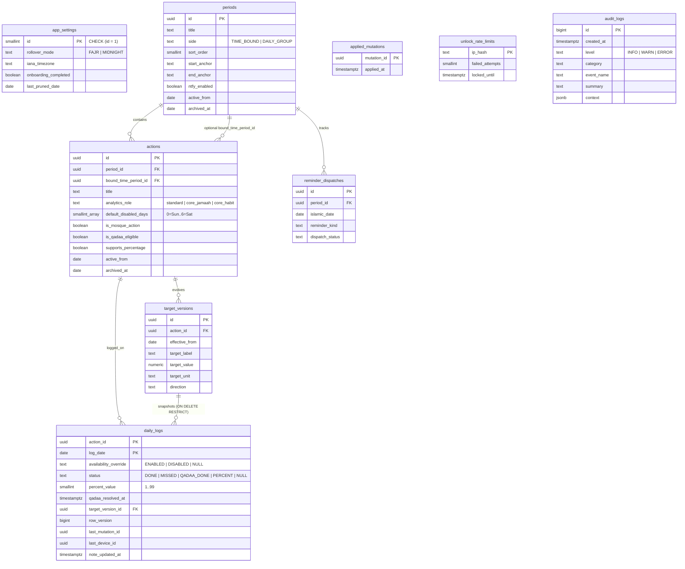

# Stage 5: Data Model, Interfaces & Security Specification — Mohasba Tracker v2

**Status:** **GATE 5 APPROVED (2026-11-21)** — Transitioned to Stage 6 (Implementation Planning)  
**Governance Mode:** Strict (SQL Schema Spec, RPC & API Contracts, Security Checklist only; zero production code files created until Stage 7 after Gate 6 approval)  
**Last Updated:** 2026-11-21  
**Upstream References:**
- [docs/01-requirements.md](file:///d:/Ahmed/Projects/mohasba/docs/01-requirements.md) *(Gate 2 Approved)*
- [docs/02-ux-design-system.md](file:///d:/Ahmed/Projects/mohasba/docs/02-ux-design-system.md) *(Gate 3 Approved)*
- [docs/03-architecture.md](file:///d:/Ahmed/Projects/mohasba/docs/03-architecture.md) *(Gate 4 Approved)*
- [docs/04b-sql-vs-app-best-practices.md](file:///d:/Ahmed/Projects/mohasba/docs/04b-sql-vs-app-best-practices.md) *(SQL vs. App Boundary Guide)*

---

## 1. Database Strategy & Entity Map (9 Lean Tables)

- **Database Engine:** **Supabase Cloud PostgreSQL 15+ (Free Tier)** accessed strictly server-side via `@supabase/supabase-js` (HTTP `fetch`, `SUPABASE_SERVICE_ROLE_KEY`).
- **Migrations:** Plain numbered SQL files (`supabase/migrations/0001_init.sql`, `0002_ux_preferences.sql`, `0003_atomic_delete_rpcs.sql`, `0004_atomic_workspace_and_unlock.sql`) + thin typed TypeScript repositories (`src/server/repositories/*`) with Zod validation — zero ORM runtime bloat.
- **SQL Discipline:** 100% of business logic lives in `src/domain/*` (TypeScript). SQL enforces declarative data integrity (`PK`, `FK`, `UNIQUE`, simple column `CHECK`) plus **6 ultra-thin, logic-free persistence/security RPCs** (`commit_sync_batch`, `trim_audit_logs_if_needed`, `delete_action_atomic`, `delete_period_atomic`, `reset_workspace_atomic`, and `record_unlock_failure_atomic`).



---

## 2. Authoritative SQL Migration Blueprint (`0001_init.sql` + `0002`–`0004`)

> Executed in Stage 7 (`supabase/migrations/0001_init.sql`, extended by `0002_ux_preferences.sql`, `0003_atomic_delete_rpcs.sql`, and `0004_atomic_workspace_and_unlock.sql` for 6 total RPCs). Compatible with Supabase Cloud when `Enable Data API = ON`, `Grant API access to new tables automatically = OFF`, and `Enable RLS on new tables automatically = ON`.

```sql
-- ============================================================================
-- Mohasba Tracker v2 — 0001_init.sql (PostgreSQL 15+ / Supabase Cloud)
-- Personal Single-Instance Schema | Declarative Integrity Only | Zero Secrets
-- Note: gen_random_uuid() is native in PostgreSQL 13+ (no pgcrypto in public)
-- ============================================================================

-- ----------------------------------------------------------------------------
-- 1. app_settings (Singleton row id = 1; ZERO secrets stored in DB)
-- ----------------------------------------------------------------------------
CREATE TABLE public.app_settings (
  id                       SMALLINT PRIMARY KEY DEFAULT 1 CHECK (id = 1),
  rollover_mode            TEXT NOT NULL DEFAULT 'FAJR'
                           CHECK (rollover_mode IN ('FAJR', 'MIDNIGHT')),
  iana_timezone            TEXT NOT NULL DEFAULT 'Africa/Cairo'
                           CHECK (char_length(iana_timezone) BETWEEN 1 AND 64),
  city_name                TEXT NOT NULL DEFAULT 'Cairo'
                           CHECK (char_length(city_name) BETWEEN 1 AND 100),
  latitude                 DOUBLE PRECISION NOT NULL DEFAULT 30.0444
                           CHECK (latitude BETWEEN -90 AND 90),
  longitude                DOUBLE PRECISION NOT NULL DEFAULT 31.2357
                           CHECK (longitude BETWEEN -180 AND 180),
  calc_method              TEXT NOT NULL DEFAULT 'Egyptian'
                           CHECK (calc_method IN ('Egyptian', 'UmmAlQura', 'MWL', 'ISNA', 'Karachi', 'Dubai', 'Kuwait', 'Qatar', 'Turkey', 'Singapore', 'MoonsightingCommittee')),
  asr_madhhab              TEXT NOT NULL DEFAULT 'Shafi'
                           CHECK (asr_madhhab IN ('Shafi', 'Hanafi')),
  prayer_offsets           JSONB NOT NULL DEFAULT '{"fajr":0,"sunrise":0,"dhuhr":0,"asr":0,"maghrib":0,"isha":0}'::jsonb,
  week_start_day           SMALLINT NOT NULL DEFAULT 6
                           CHECK (week_start_day BETWEEN 0 AND 6), -- 0=Sun .. 6=Sat
  ntfy_master_enabled      BOOLEAN NOT NULL DEFAULT false,
  quiet_start_hhmm         TEXT NULL CHECK (quiet_start_hhmm IS NULL OR quiet_start_hhmm ~ '^([01][0-9]|2[0-3]):[0-5][0-9]$'),
  quiet_end_hhmm           TEXT NULL CHECK (quiet_end_hhmm IS NULL OR quiet_end_hhmm ~ '^([01][0-9]|2[0-3]):[0-5][0-9]$'),
  digest_enabled           BOOLEAN NOT NULL DEFAULT true,
  digest_hhmm              TEXT NOT NULL DEFAULT '22:00'
                           CHECK (digest_hhmm ~ '^([01][0-9]|2[0-3]):[0-5][0-9]$'),
  backup_reminder_enabled  BOOLEAN NOT NULL DEFAULT true,
  onboarding_completed     BOOLEAN NOT NULL DEFAULT false,
  last_pruned_date         DATE NULL,
  created_at               TIMESTAMPTZ NOT NULL DEFAULT now(),
  updated_at               TIMESTAMPTZ NOT NULL DEFAULT now()
);

INSERT INTO public.app_settings (id) VALUES (1) ON CONFLICT (id) DO NOTHING;

-- ----------------------------------------------------------------------------
-- 2. periods (Right TIME_BOUND prayer windows + Left DAILY_GROUP habits)
-- ----------------------------------------------------------------------------
CREATE TABLE public.periods (
  id                UUID PRIMARY KEY DEFAULT gen_random_uuid(),
  title             TEXT NOT NULL CHECK (char_length(trim(title)) BETWEEN 1 AND 80),
  side              TEXT NOT NULL CHECK (side IN ('TIME_BOUND', 'DAILY_GROUP')),
  sort_order        SMALLINT NOT NULL DEFAULT 0,
  start_anchor      TEXT NULL CHECK (start_anchor IS NULL OR start_anchor IN ('FAJR', 'SUNRISE', 'DHUHR', 'ASR', 'MAGHRIB', 'ISHA', 'FIXED_TIME')),
  start_offset_min  SMALLINT NOT NULL DEFAULT 0 CHECK (start_offset_min BETWEEN -360 AND 360),
  start_fixed_hhmm  TEXT NULL CHECK (start_fixed_hhmm IS NULL OR start_fixed_hhmm ~ '^([01][0-9]|2[0-3]):[0-5][0-9]$'),
  end_anchor        TEXT NULL CHECK (end_anchor IS NULL OR end_anchor IN ('FAJR', 'SUNRISE', 'DHUHR', 'ASR', 'MAGHRIB', 'ISHA', 'FIXED_TIME')),
  end_offset_min    SMALLINT NOT NULL DEFAULT 0 CHECK (end_offset_min BETWEEN -360 AND 360),
  end_fixed_hhmm    TEXT NULL CHECK (end_fixed_hhmm IS NULL OR end_fixed_hhmm ~ '^([01][0-9]|2[0-3]):[0-5][0-9]$'),
  ntfy_enabled      BOOLEAN NOT NULL DEFAULT true,
  ntfy_mode         TEXT NULL CHECK (ntfy_mode IS NULL OR ntfy_mode IN ('pre_expiry', 'post_start')),
  ntfy_offset_min   SMALLINT NOT NULL DEFAULT 25 CHECK (ntfy_offset_min BETWEEN 1 AND 180),
  active_from       DATE NOT NULL DEFAULT CURRENT_DATE,
  archived_at       DATE NULL,
  created_at        TIMESTAMPTZ NOT NULL DEFAULT now(),
  updated_at        TIMESTAMPTZ NOT NULL DEFAULT now(),

  CONSTRAINT periods_archive_after_active CHECK (archived_at IS NULL OR archived_at >= active_from),
  CONSTRAINT periods_time_bound_anchors CHECK (
    (side = 'TIME_BOUND' AND start_anchor IS NOT NULL AND end_anchor IS NOT NULL)
    OR (side = 'DAILY_GROUP' AND start_anchor IS NULL AND end_anchor IS NULL)
  ),
  CONSTRAINT periods_fixed_time_required CHECK (
    (start_anchor <> 'FIXED_TIME' OR start_fixed_hhmm IS NOT NULL)
    AND (end_anchor <> 'FIXED_TIME' OR end_fixed_hhmm IS NOT NULL)
  )
);

-- ----------------------------------------------------------------------------
-- 3. actions (Stable identity across renames, moves, target upgrades, soft-archive)
-- ----------------------------------------------------------------------------
CREATE TABLE public.actions (
  id                          UUID PRIMARY KEY DEFAULT gen_random_uuid(),
  period_id                   UUID NOT NULL REFERENCES public.periods(id) ON DELETE RESTRICT,
  bound_time_period_id        UUID NULL REFERENCES public.periods(id) ON DELETE SET NULL,
  title                       TEXT NOT NULL CHECK (char_length(trim(title)) BETWEEN 1 AND 120),
  sort_order                  SMALLINT NOT NULL DEFAULT 0,
  is_mosque_action            BOOLEAN NOT NULL DEFAULT false,
  is_qadaa_eligible           BOOLEAN NOT NULL DEFAULT false,
  supports_percentage         BOOLEAN NOT NULL DEFAULT false,
  include_in_normal_day_preset BOOLEAN NOT NULL DEFAULT false,
  analytics_role              TEXT NOT NULL DEFAULT 'standard'
                              CHECK (analytics_role IN ('standard', 'core_jamaah', 'core_habit')),
  default_disabled_days       SMALLINT[] NOT NULL DEFAULT '{}'::smallint[]
                              CHECK (default_disabled_days <@ ARRAY[0,1,2,3,4,5,6]::smallint[]), -- 0=Sun..6=Sat
  active_from                 DATE NOT NULL DEFAULT CURRENT_DATE,
  archived_at                 DATE NULL,
  created_at                  TIMESTAMPTZ NOT NULL DEFAULT now(),
  updated_at                  TIMESTAMPTZ NOT NULL DEFAULT now(),

  CONSTRAINT actions_archive_after_active CHECK (archived_at IS NULL OR archived_at >= active_from)
);

-- ----------------------------------------------------------------------------
-- 4. target_versions (Append-only Target Evolution / تطوير الهدف)
-- ----------------------------------------------------------------------------
CREATE TABLE public.target_versions (
  id              UUID PRIMARY KEY DEFAULT gen_random_uuid(),
  action_id       UUID NOT NULL REFERENCES public.actions(id) ON DELETE RESTRICT,
  effective_from  DATE NOT NULL,
  target_label    TEXT NOT NULL CHECK (char_length(trim(target_label)) BETWEEN 1 AND 80),
  target_value    NUMERIC NULL CHECK (target_value IS NULL OR target_value > 0),
  target_unit     TEXT NULL CHECK (target_unit IS NULL OR char_length(trim(target_unit)) BETWEEN 1 AND 32),
  direction       TEXT NOT NULL DEFAULT 'level_up'
                  CHECK (direction IN ('level_up', 'step_down', 'adjustment')),
  created_at      TIMESTAMPTZ NOT NULL DEFAULT now(),

  CONSTRAINT target_versions_action_effective_uidx UNIQUE (action_id, effective_from),
  CONSTRAINT target_versions_id_action_uidx UNIQUE (id, action_id)
);

-- ----------------------------------------------------------------------------
-- 5. daily_logs (Single 2-layer cell table | Tombstone-preserving | No Hard DELETE)
-- ----------------------------------------------------------------------------
CREATE TABLE public.daily_logs (
  action_id              UUID NOT NULL REFERENCES public.actions(id) ON DELETE RESTRICT,
  log_date               DATE NOT NULL,
  availability_override  TEXT NULL CHECK (availability_override IS NULL OR availability_override IN ('ENABLED', 'DISABLED')),
  status                 TEXT NULL CHECK (status IS NULL OR status IN ('DONE', 'MISSED', 'QADAA_DONE', 'PERCENT')),
  percent_value          SMALLINT NULL CHECK (percent_value IS NULL OR (percent_value BETWEEN 1 AND 99)),
  qadaa_resolved_at      TIMESTAMPTZ NULL,
  target_version_id      UUID NULL,
  note                   TEXT NULL CHECK (note IS NULL OR char_length(note) <= 2000),
  note_updated_at        TIMESTAMPTZ NULL,
  row_version            BIGINT NOT NULL DEFAULT 1 CHECK (row_version >= 1),
  last_mutation_id       UUID NULL,
  last_device_id         UUID NULL,
  client_updated_at      TIMESTAMPTZ NOT NULL,
  created_at             TIMESTAMPTZ NOT NULL DEFAULT now(),
  updated_at             TIMESTAMPTZ NOT NULL DEFAULT now(),

  PRIMARY KEY (action_id, log_date),

  -- Composite FK guarantees target_version_id belongs to THIS action AND cannot be deleted once referenced
  CONSTRAINT daily_logs_target_version_fk
    FOREIGN KEY (target_version_id, action_id)
    REFERENCES public.target_versions (id, action_id)
    ON DELETE RESTRICT,

  -- SQL 3-valued-logic-safe CHECK constraints (NULL-proof)
  CONSTRAINT daily_logs_percent_consistency
    CHECK (
      (status IS NOT DISTINCT FROM 'PERCENT' AND percent_value IS NOT NULL)
      OR (status IS DISTINCT FROM 'PERCENT' AND percent_value IS NULL)
    ),
  CONSTRAINT daily_logs_qadaa_consistency
    CHECK (
      (status IS NOT DISTINCT FROM 'QADAA_DONE' AND qadaa_resolved_at IS NOT NULL)
      OR (status IS DISTINCT FROM 'QADAA_DONE' AND qadaa_resolved_at IS NULL)
    ),
  CONSTRAINT daily_logs_disabled_has_no_status
    CHECK (availability_override IS DISTINCT FROM 'DISABLED' OR status IS NULL)
);

-- ----------------------------------------------------------------------------
-- 6. applied_mutations (Sync Idempotency Ledger; pruned > 90d daily)
-- ----------------------------------------------------------------------------
CREATE TABLE public.applied_mutations (
  mutation_id  UUID PRIMARY KEY,
  applied_at   TIMESTAMPTZ NOT NULL DEFAULT now()
);

-- ----------------------------------------------------------------------------
-- 7. reminder_dispatches (Atomic ntfy Anti-Spam Claims; pruned > 90d daily)
-- ----------------------------------------------------------------------------
CREATE TABLE public.reminder_dispatches (
  id               UUID PRIMARY KEY DEFAULT gen_random_uuid(),
  period_id        UUID NULL REFERENCES public.periods(id) ON DELETE CASCADE,
  islamic_date     DATE NOT NULL,
  reminder_kind    TEXT NOT NULL CHECK (reminder_kind IN ('pre_expiry', 'post_start', 'nightly_digest', 'backup_nudge')),
  dispatch_status  TEXT NOT NULL DEFAULT 'sending' CHECK (dispatch_status IN ('sending', 'sent', 'failed')),
  dispatched_at    TIMESTAMPTZ NOT NULL DEFAULT now(),
  error_message    TEXT NULL CHECK (error_message IS NULL OR char_length(error_message) <= 500),

  -- Postgres 15+ NULLS NOT DISTINCT prevents duplicate NULL-period digests/nudges on the same day
  CONSTRAINT reminder_dispatches_unique_claim
    UNIQUE NULLS NOT DISTINCT (period_id, islamic_date, reminder_kind)
);

-- ----------------------------------------------------------------------------
-- 8. unlock_rate_limits (Per-IP Hashed Brute-Force Protection; pruned daily)
-- ----------------------------------------------------------------------------
CREATE TABLE public.unlock_rate_limits (
  ip_hash          TEXT PRIMARY KEY,
  failed_attempts  SMALLINT NOT NULL DEFAULT 0 CHECK (failed_attempts >= 0),
  locked_until     TIMESTAMPTZ NULL,
  updated_at       TIMESTAMPTZ NOT NULL DEFAULT now()
);

-- ----------------------------------------------------------------------------
-- 9. audit_logs (Detailed Action & Error Log; 25 MB / 35,000-row safe ring buffer)
-- ----------------------------------------------------------------------------
CREATE TABLE public.audit_logs (
  id           BIGINT GENERATED ALWAYS AS IDENTITY PRIMARY KEY,
  created_at   TIMESTAMPTZ NOT NULL DEFAULT now(),
  level        TEXT NOT NULL CHECK (level IN ('INFO', 'WARN', 'ERROR')),
  category     TEXT NOT NULL CHECK (category IN ('SYNC', 'CRUD', 'TARGET', 'CRON', 'AUTH', 'EXPORT_IMPORT', 'SYSTEM')),
  event_name   TEXT NOT NULL CHECK (char_length(event_name) BETWEEN 1 AND 80),
  request_id   TEXT NULL CHECK (request_id IS NULL OR char_length(request_id) <= 64),
  device_id    UUID NULL,
  entity_type  TEXT NULL CHECK (entity_type IS NULL OR char_length(entity_type) <= 40),
  entity_id    TEXT NULL CHECK (entity_id IS NULL OR char_length(entity_id) <= 80),
  summary      TEXT NOT NULL CHECK (char_length(summary) <= 500),
  context      JSONB NOT NULL DEFAULT '{}'::jsonb,
  error_stack  TEXT NULL CHECK (error_stack IS NULL OR char_length(error_stack) <= 1500)
);

-- ============================================================================
-- Query-Driven Minimal Indexes (Zero Redundant Indexes)
-- ============================================================================
CREATE INDEX actions_period_sort_idx
  ON public.actions (period_id, sort_order);

CREATE INDEX actions_bound_period_idx
  ON public.actions (bound_time_period_id)
  WHERE bound_time_period_id IS NOT NULL;

CREATE INDEX target_versions_action_effective_desc_idx
  ON public.target_versions (action_id, effective_from DESC);

CREATE INDEX daily_logs_log_date_idx
  ON public.daily_logs (log_date);

CREATE INDEX daily_logs_updated_at_idx
  ON public.daily_logs (updated_at);

CREATE INDEX daily_logs_open_qadaa_idx
  ON public.daily_logs (action_id, log_date)
  WHERE status = 'MISSED' AND availability_override IS DISTINCT FROM 'DISABLED';

CREATE INDEX daily_logs_target_version_idx
  ON public.daily_logs (target_version_id)
  WHERE target_version_id IS NOT NULL;

CREATE INDEX applied_mutations_applied_at_idx
  ON public.applied_mutations (applied_at);

CREATE INDEX audit_logs_created_at_desc_idx
  ON public.audit_logs (created_at DESC);

CREATE INDEX audit_logs_warn_error_idx
  ON public.audit_logs (level, created_at DESC)
  WHERE level IN ('ERROR', 'WARN');

-- ============================================================================
-- Ultra-Thin, Logic-Free Persistence RPCs (Only 2 Functions; Zero Business Logic)
-- ============================================================================

-- RPC 1: commit_sync_batch
-- Receives pre-resolved rows from TS `src/domain/conflict.ts` (ZERO business logic in SQL).
-- CRITICAL CONTRACT: `expected_row_version` is the `row_version` that `sync-service.ts` READ
-- from Postgres immediately before running `domain/conflict.ts` (NULL if row did not exist),
-- NOT the client's stale `base_row_version` (otherwise Conflict-Path resolutions could never commit!).
-- Per-item subtransaction (`BEGIN ... EXCEPTION`) guarantees:
--   1. Atomic `mutation_id` claim (`INSERT ... ON CONFLICT DO NOTHING`) safe against parallel duplicate requests.
--   2. Strict Create (`expected_row_version IS NULL` -> `ON CONFLICT DO NOTHING`) vs Update (`WHERE row_version = expected`)
--      so concurrent new-row inserts under READ COMMITTED NEVER silently overwrite each other.
--   3. Custom SQLSTATE `'MC001'` isolates optimistic race rollbacks; `data_exception` / `integrity_constraint_violation`
--      roll back ONLY the offending item (`rejected`) without aborting healthy items in the batch.
CREATE OR REPLACE FUNCTION public.commit_sync_batch(p_items JSONB)
RETURNS JSONB
LANGUAGE plpgsql
SECURITY INVOKER
SET search_path = ''
AS $$
DECLARE
  v_item         JSONB;
  v_mut_id       UUID;
  v_action_id    UUID;
  v_log_date     DATE;
  v_exp_ver      BIGINT;
  v_claimed      INTEGER;
  v_existing     public.daily_logs%ROWTYPE;
  v_written      public.daily_logs%ROWTYPE;
  v_results      JSONB := '[]'::jsonb;
BEGIN
  IF p_items IS NULL OR pg_catalog.jsonb_typeof(p_items) <> 'array' THEN
    RAISE EXCEPTION 'p_items must be a JSON array';
  END IF;

  FOR v_item IN SELECT value FROM pg_catalog.jsonb_array_elements(p_items)
  LOOP
    v_mut_id    := (v_item->>'mutation_id')::UUID;
    v_action_id := (v_item->>'action_id')::UUID;
    v_log_date  := (v_item->>'log_date')::DATE;
    v_exp_ver   := NULLIF(v_item->>'expected_row_version', '')::BIGINT;

    BEGIN
      -- 1. Atomic idempotency claim (prevents parallel duplicate-request race)
      INSERT INTO public.applied_mutations (mutation_id)
      VALUES (v_mut_id)
      ON CONFLICT (mutation_id) DO NOTHING;

      GET DIAGNOSTICS v_claimed = ROW_COUNT;

      IF v_claimed = 0 THEN
        SELECT * INTO v_existing
        FROM public.daily_logs
        WHERE action_id = v_action_id AND log_date = v_log_date;

        v_results := v_results || pg_catalog.jsonb_build_array(
          pg_catalog.jsonb_build_object(
            'mutation_id', v_mut_id,
            'outcome', 'already_applied',
            'resolved_row', CASE WHEN FOUND THEN pg_catalog.to_jsonb(v_existing) ELSE NULL END
          )
        );
        CONTINUE;
      END IF;

      -- 2. Strict Create vs. Optimistic Update (no unconditional ON CONFLICT DO UPDATE!)
      IF v_exp_ver IS NULL THEN
        INSERT INTO public.daily_logs (
          action_id, log_date, availability_override, status, percent_value,
          qadaa_resolved_at, target_version_id, note, note_updated_at,
          row_version, last_mutation_id, last_device_id, client_updated_at, updated_at
        ) VALUES (
          v_action_id,
          v_log_date,
          NULLIF(v_item->>'availability_override', ''),
          NULLIF(v_item->>'status', ''),
          NULLIF(v_item->>'percent_value', '')::SMALLINT,
          NULLIF(v_item->>'qadaa_resolved_at', '')::TIMESTAMPTZ,
          NULLIF(v_item->>'target_version_id', '')::UUID,
          v_item->>'note',
          NULLIF(v_item->>'note_updated_at', '')::TIMESTAMPTZ,
          1,
          v_mut_id,
          NULLIF(v_item->>'device_id', '')::UUID,
          (v_item->>'client_updated_at')::TIMESTAMPTZ,
          pg_catalog.now()
        )
        ON CONFLICT (action_id, log_date) DO NOTHING
        RETURNING * INTO v_written;

        IF NOT FOUND THEN
          -- Concurrent transaction inserted this cell first -> roll back applied_mutations claim for this item
          RAISE EXCEPTION USING ERRCODE = 'MC001';
        END IF;
      ELSE
        UPDATE public.daily_logs SET
          availability_override = NULLIF(v_item->>'availability_override', ''),
          status                = NULLIF(v_item->>'status', ''),
          percent_value         = NULLIF(v_item->>'percent_value', '')::SMALLINT,
          qadaa_resolved_at     = NULLIF(v_item->>'qadaa_resolved_at', '')::TIMESTAMPTZ,
          target_version_id     = NULLIF(v_item->>'target_version_id', '')::UUID,
          note                  = v_item->>'note',
          note_updated_at       = NULLIF(v_item->>'note_updated_at', '')::TIMESTAMPTZ,
          row_version           = public.daily_logs.row_version + 1,
          last_mutation_id      = v_mut_id,
          last_device_id        = NULLIF(v_item->>'device_id', '')::UUID,
          client_updated_at     = (v_item->>'client_updated_at')::TIMESTAMPTZ,
          updated_at            = pg_catalog.now()
        WHERE action_id = v_action_id
          AND log_date = v_log_date
          AND row_version = v_exp_ver
        RETURNING * INTO v_written;

        IF NOT FOUND THEN
          -- Row version moved (or row absent) -> roll back applied_mutations claim for this item
          RAISE EXCEPTION USING ERRCODE = 'MC001';
        END IF;
      END IF;

      v_results := v_results || pg_catalog.jsonb_build_array(
        pg_catalog.jsonb_build_object(
          'mutation_id', v_mut_id,
          'outcome', 'applied',
          'resolved_row', pg_catalog.to_jsonb(v_written)
        )
      );

    EXCEPTION
      WHEN SQLSTATE 'MC001' THEN
        SELECT * INTO v_existing
        FROM public.daily_logs
        WHERE action_id = v_action_id AND log_date = v_log_date;

        v_results := v_results || pg_catalog.jsonb_build_array(
          pg_catalog.jsonb_build_object(
            'mutation_id', v_mut_id,
            'outcome', 'race_conflict',
            'resolved_row', CASE WHEN FOUND THEN pg_catalog.to_jsonb(v_existing) ELSE NULL END
          )
        );

      WHEN data_exception OR integrity_constraint_violation THEN
        v_results := v_results || pg_catalog.jsonb_build_array(
          pg_catalog.jsonb_build_object(
            'mutation_id', v_mut_id,
            'outcome', 'rejected',
            'error', SQLERRM
          )
        );
    END;
  END LOOP;

  RETURN v_results;
END;
$$;

-- RPC 2: trim_audit_logs_if_needed
-- Deterministic row-count ring buffer (35,000 rows ≈ ~25 MiB typical) + 100 MiB emergency ceiling:
-- Trims at most 1 batch of oldest rows > 7 days old per daily tick; reports `pg_total_relation_size` for monitoring.
CREATE OR REPLACE FUNCTION public.trim_audit_logs_if_needed(
  p_max_rows        BIGINT  DEFAULT 35000,
  p_emergency_bytes BIGINT  DEFAULT 104857600, -- 100 MiB worst-case ceiling
  p_batch_limit     INTEGER DEFAULT 1000
)
RETURNS JSONB
LANGUAGE plpgsql
SECURITY INVOKER
SET search_path = ''
AS $$
DECLARE
  v_bytes   BIGINT;
  v_rows    BIGINT;
  v_deleted INTEGER := 0;
BEGIN
  SELECT pg_catalog.pg_total_relation_size('public.audit_logs') INTO v_bytes;
  SELECT count(*) INTO v_rows FROM public.audit_logs;

  IF v_rows > p_max_rows OR v_bytes > p_emergency_bytes THEN
    WITH oldest AS (
      SELECT id
      FROM public.audit_logs
      WHERE created_at < pg_catalog.now() - INTERVAL '7 days'
      ORDER BY id ASC
      LIMIT p_batch_limit
    )
    DELETE FROM public.audit_logs a
    USING oldest o
    WHERE a.id = o.id;

    GET DIAGNOSTICS v_deleted = ROW_COUNT;
  END IF;

  RETURN pg_catalog.jsonb_build_object(
    'bytes_observed', v_bytes,
    'rows_before', v_rows,
    'deleted_count', v_deleted
  );
END;
$$;

-- ============================================================================
-- Security Lockdown: Default-Deny RLS + Explicit REVOKE + Explicit service_role GRANT
-- ============================================================================
ALTER TABLE public.app_settings        ENABLE ROW LEVEL SECURITY;
ALTER TABLE public.periods             ENABLE ROW LEVEL SECURITY;
ALTER TABLE public.actions             ENABLE ROW LEVEL SECURITY;
ALTER TABLE public.target_versions     ENABLE ROW LEVEL SECURITY;
ALTER TABLE public.daily_logs          ENABLE ROW LEVEL SECURITY;
ALTER TABLE public.applied_mutations   ENABLE ROW LEVEL SECURITY;
ALTER TABLE public.reminder_dispatches ENABLE ROW LEVEL SECURITY;
ALTER TABLE public.unlock_rate_limits  ENABLE ROW LEVEL SECURITY;
ALTER TABLE public.audit_logs          ENABLE ROW LEVEL SECURITY;

REVOKE ALL ON ALL TABLES    IN SCHEMA public FROM PUBLIC, anon, authenticated;
REVOKE ALL ON ALL SEQUENCES IN SCHEMA public FROM PUBLIC, anon, authenticated;
REVOKE ALL ON ALL FUNCTIONS IN SCHEMA public FROM PUBLIC, anon, authenticated;

ALTER DEFAULT PRIVILEGES FOR ROLE postgres IN SCHEMA public
  REVOKE ALL ON TABLES FROM PUBLIC, anon, authenticated;
ALTER DEFAULT PRIVILEGES FOR ROLE postgres IN SCHEMA public
  REVOKE ALL ON SEQUENCES FROM PUBLIC, anon, authenticated;
ALTER DEFAULT PRIVILEGES FOR ROLE postgres IN SCHEMA public
  REVOKE ALL ON FUNCTIONS FROM PUBLIC, anon, authenticated;

-- Mandatory explicit grants for service_role (required when Supabase auto-API-grant is OFF)
GRANT USAGE ON SCHEMA public TO service_role;
GRANT SELECT, INSERT, UPDATE, DELETE ON ALL TABLES    IN SCHEMA public TO service_role;
GRANT USAGE, SELECT                  ON ALL SEQUENCES IN SCHEMA public TO service_role;
GRANT EXECUTE ON FUNCTION public.commit_sync_batch(JSONB) TO service_role;
GRANT EXECUTE ON FUNCTION public.trim_audit_logs_if_needed(BIGINT, BIGINT, INTEGER) TO service_role;
```

---

## 3. API Surface & Interface Contracts (26 Active Operations / 22 Resource Routes)

All endpoints export `dynamic = 'force-dynamic'`, validate input with **Zod**, and return consistent JSON errors:
`{ error: { code: string, message: string, details?: unknown }, request_id: string }`.

### Mandatory Keyset Pagination & Delta Overlap Rule (Supabase 1,000-Row PostgREST Limit)
Supabase PostgREST caps a single `.select()` at **1,000 rows** by default, and `.range(offset)` can skip or duplicate rows if a concurrent sync inserts rows mid-export. Therefore:
- **`GET /api/bootstrap`**, **`GET /api/logs`**, and **`GET /api/export` MUST** use **Keyset Pagination** over `(log_date ASC, action_id ASC)` (page size `1,000`, next page filtered by `log_date > lastDate OR (log_date = lastDate AND action_id > lastActionId)`) looping until `page.length < 1000`.
- **`GET /api/bootstrap?since=<ISO>` (Delta Mode)** MUST apply a **5-minute safety overlap** (`updated_at >= since - 5 minutes`) to eliminate clock-skew and in-flight Postgres transaction visibility misses (safe because client IDB merge is idempotent).

### Access & Guard Matrix
| Guard | Applies To | Behavior |
| :--- | :--- | :--- |
| **`Public Liveness`** | `GET /api/health` | Unauthenticated `{ ok: true }` (zero private data; for Oracle VPS Docker `healthcheck`). |
| **`Unlock Entry`** | `POST /api/unlock` | Enforces fail-closed check + `Origin`/`Sec-Fetch-Site` CSRF + `application/json` + per-IP hashed Postgres rate-limit (`5` failures → `429` 60s cooldown). |
| **`Session + CSRF`** | All App API routes (`/api/bootstrap*`, `/api/sync`, `/api/logs`, `/api/export`, `/api/import`, `/api/settings*`, `/api/periods*`, `/api/actions*`, `/api/target-versions*`, `/api/schema/reorder`, `/api/audit-logs`, `/api/logout`) | In production without `APP_PASSCODE` and without `ALLOW_UNAUTHENTICATED=true` → `503 { code: 'SETUP_INCOMPLETE' }`. When `APP_PASSCODE` is set → validates 180-day `mohasba_session` HMAC cookie (`401 { code: 'UNLOCK_REQUIRED' }`). All `POST`/`PATCH`/`DELETE` routes also require matching `Origin` (`APP_URL` / same-origin) or `Sec-Fetch-Site: same-origin` + `Content-Type: application/json` (except `DELETE /api/periods/[id]` and `DELETE /api/actions/[id]`, which set `requireJsonContentType: false` and accept either `?force=true` or optional JSON `{ force: true }`). |
| **`Cron Secret`** | `POST /api/cron/tick` | Constant-time Web Crypto check on `Authorization: Bearer <CRON_SECRET>` (`503` if unset, `401` on mismatch; `GET` → `405`). |

### Complete Endpoint Reference (26 Active Operations across 22 Routes, plus `GET /api/cron/tick` `405`)
| # | Method & Path | Purpose & Key Contract Rules |
| :-: | :--- | :--- |
| 1 | `GET /api/health` | Liveness check (`200 { ok: true }`). |
| 2 | `POST /api/unlock` | Body `{ passcode }`. Verifies `APP_PASSCODE` + atomic per-IP rate limit (`record_unlock_failure_atomic` in `0004_atomic_workspace_and_unlock.sql`) → sets `HttpOnly; SameSite=Lax` cookie (`Secure` on HTTPS), signed with `HKDF(CRON_SECRET + ":" + APP_PASSCODE, "mohasba-session-v1")`. |
| 3 | `POST /api/logout` | Clears `mohasba_session` cookie (`Max-Age=0`); client wipes all 4 IDB stores afterward. |
| 4 | `GET /api/bootstrap` | Optional `?since=<ISO>`. Full mode uses **mandatory pagination** to return `{ server_now, ntfy_configured, settings, periods, actions, target_versions, daily_logs (complete 90d + all open Qadaa rows) }`. Delta mode paginates logs where `updated_at > since`. Also drives cold-boot status (`200` / `401` / `503`). |
| 5 | `POST /api/bootstrap/init` | Body `{ mode: 'starter_pack' | 'blank' | 'template', level?: 'level_1' | 'level_2' | 'level_3', excluded_period_ids?, excluded_action_ids?, custom_actions?, ntfy_all_periods_enabled?, settings_patch? }` *(Post-Gate Amendment 2026-11-27)*. **Idempotent & resumable:** Guards strictly on **`!settings.onboarding_completed`**; validates & applies optional `settings_patch` (including SSRF `validateNtfyTopicUrl`) BEFORE seeding periods/actions, uses deterministic fixed UUIDs (`ON CONFLICT (id) DO NOTHING`), clears orphan `bound_time_period_id` references on excluded periods, and sets `onboarding_completed = true` **last**. |
| 5b | `POST /api/bootstrap/merge-template` | Body `{ level: 'level_1' | 'level_2' | 'level_3', active_from?, excluded_period_ids?, excluded_action_ids? }` *(Post-Gate Amendment 2026-11-28)*. Online-only (Passcode + CSRF). Guards on `settings.onboarding_completed === true`; runs pure `planTemplateMerge` to match existing active periods (ID / normalized Arabic title / unique prayer window / majority action overlap) and skip existing actions, inserts ONLY net-new `periods`, `actions`, and `target_versions` (remapping any archived ID collisions), and logs `template_merged` to `audit_logs` with zero mutations to existing logs. |
| 5c | `POST /api/bootstrap/reset` | Body `{ confirm: 'RESET_WORKSPACE' }` *(Post-Gate Amendment 2026-11-28)*. Online-only (Passcode + CSRF). Executes atomic `reset_workspace_atomic` (`0004_atomic_workspace_and_unlock.sql`) to clear schedule & log tables in strict FK order (`daily_logs` → `target_versions` → `actions` → `reminder_dispatches` → `periods` → `applied_mutations`) and set `app_settings.onboarding_completed = false` inside one transaction while preserving city/rollover/`ntfy`/UI/shortcut settings, logs `workspace_reset` to `audit_logs`, and instructs client to wipe IDB cache & reopen the 3-Level Onboarding Wizard. |
| 6 | `POST /api/sync` | Body `{ device_id, mutations: SyncMutation[] (1..50) }`. Server bulk-reads (2–4 queries) → resolves via `src/domain/conflict.ts` → commits via `commit_sync_batch` (retrying any `race_conflict` row once after fresh re-read) → returns `{ server_now, results: [{ mutation_id, outcome: 'applied' | 'already_applied' | 'rejected' | 'race_conflict', resolved_row?, error? }] }`. Per-item DB constraint violations roll back **only that item** via PL/pgSQL subtransaction (`rejected`) without aborting healthy items. |
| 7 | `GET /api/logs` | Query `?from=YYYY-MM-DD&to=YYYY-MM-DD` (max 366d span). Uses **mandatory pagination** to lazy-load complete historical weeks beyond the 90d bootstrap window. |
| 8 | `GET /api/export` | **Interactive user backup (Session Cookie protected):** Uses **mandatory pagination** to assemble a complete all-time JSON snapshot (`schema_version: 1`, `exported_at`, `settings`, `periods`, `actions`, `target_versions`, **all** `daily_logs`, plus `counts` summary for completeness checks) with `Content-Disposition: attachment; filename="mohasba-YYYY-MM-DD.json"`. Zero secrets included. *(Note: Unattended VPS weekly backup uses `pg_dump`, NOT this cookie-protected route—see §4.2.)* |
| 9 | `POST /api/import` | Idempotent chunked merge import (`<= 200` logs/request). Restores `settings`/`periods`/`actions`/`target_versions` before `daily_logs` (matching target versions by UUID then `(action_id, effective_from)`), validates cross-action references, and merges logs via `src/domain/conflict.ts`. |
| 10 | `PATCH /api/settings` | Online-only (client enforces deadlock-free Drain-Before-CRUD). Updates `app_settings` row `id = 1`. |
| 11 | `POST /api/settings/test-ntfy` | Sends a single test Arabic notification to `NTFY_TOPIC_URL` (`AbortSignal.timeout(5000)`); returns `{ ok, status }` (or `400` if `NTFY_TOPIC_URL` unset). |
| 12 | `POST /api/periods` | Online-only. Creates a custom `TIME_BOUND` or `DAILY_GROUP` period. |
| 13 | `PATCH` & `DELETE /api/periods/[id]` | Online-only *(Post-Gate Amendment 2026-11-27)*. `PATCH` edits title, anchors/offsets, per-period `ntfy_*`, or soft-archives/restores. `DELETE` sets `requireJsonContentType: false` and executes **Smart 2-Tier Atomic Delete** via `delete_period_atomic` (`0003_atomic_delete_rpcs.sql`, `SECURITY INVOKER`, `REVOKE` from `PUBLIC/anon/authenticated`): instant `200` if `0` children, `0` bound habits, & `0` logs; returns `409 HAS_CHILDREN` / `HAS_HISTORY` with `{ action_count, log_count, bound_action_count }` unless `?force=true` or JSON `{ force: true }` (atomically cascades `daily_logs` → `target_versions` → `actions` → `period` + writes `audit_logs`). |
| 14 | `POST /api/actions` | Online-only. Creates a new action + optional initial `target_version`. |
| 15 | `PATCH` & `DELETE /api/actions/[id]` | Online-only *(Post-Gate Amendment 2026-11-27)*. `PATCH` handles Simple Rename, period move, flag updates, or soft-archive/restore. `DELETE` sets `requireJsonContentType: false` and executes **Smart 2-Tier Atomic Delete** via `delete_action_atomic` (`0003_atomic_delete_rpcs.sql`): instant `200` if `0` non-tombstone `daily_logs`; returns `409 HAS_HISTORY` with `{ log_count }` unless `?force=true` or JSON `{ force: true }` (atomically cascades `daily_logs` → `target_versions` → `action` + writes `audit_logs`). |
| 16 | `POST /api/target-versions` | Online-only (Drain-Before-CRUD). Appends a new Target Evolution (`تطوير الهدف`) version enforcing `effective_from` uniqueness (`409` on duplicate date). |
| 17–18 | `PATCH` & `DELETE /api/target-versions/[id]` | Online-only. Allowed **ONLY while zero `daily_logs` reference this version**; returns `409 Conflict` if referenced (enforced by both app check and `ON DELETE RESTRICT`). |
| 19 | `POST /api/schema/reorder` | Online-only, **idempotent per-row `UPDATE` & retry-safe:** Accepts `{ target: 'periods' | 'actions', items: [{ id, sort_order, period_id? }] }` (bounded `<= 300` items to support Level 3's 118 actions). Executes explicit `.update({ sort_order, period_id? }).eq('id', item.id)` per row (avoiding PostgREST partial-row `.upsert()` `NOT NULL` violations on `title`/`side`/`period_id` without adding a 3rd RPC!). Returns `{ updated_count, failed_ids }`; on partial failure, client refreshes `/api/bootstrap` to display true server state and allows safe retry. |
| 20 | `GET /api/audit-logs` & `POST /api/cron/tick` | `GET /api/audit-logs` (Session-protected, `?level=&category=&limit=50`, max 100) for fast error inspection. `POST /api/cron/tick` (`CRON_SECRET`-protected) invokes `runCronTick(config)`: `app_settings` read (keep-alive), daily prune (`applied_mutations > 90d`, `reminder_dispatches > 90d`, expired `unlock_rate_limits`, `trim_audit_logs_if_needed()`), biweekly backup nudge, and `ntfy` dispatches. |

---

## 4. Observability, Automated Backup Strategy & Security Verification Checklist

### 4.1 Hybrid Observability & Privacy Scrubbing Rules
- **JSON Stdout (`console.log`/`console.error`):** Routine `200 OK` access logs (`{ ts, level, reqId, route, status, ms }`) — zero DB cost.
- **Postgres `audit_logs`:** Records all `ERROR` / `WARN` events (5xx, sync exceptions, `ntfy` failures, client-reported `attention_needed` errors) + high-signal `INFO` events (sync conflicts resolved, Settings/Schema/Target CRUD, unlock lockouts, export/import).
- **Non-Blocking & Fail-Safe:** Audit inserts run inside `try/catch` (falling back to stdout) and never block or fail primary prayer-log writes.
- **Strict Secret & Personal-Note Scrubbing (`sanitizeAuditContext`):**
  - Recursively redacts any key matching `/passcode|secret|token|cookie|authorization|password|topic_url|service_role|key/i`.
  - **Never logs raw user `note` content** inside `audit_logs.context` (log only `{ has_note: boolean, note_length: number }`) so personal spiritual notes stay exclusively in `daily_logs`.
  - Caps `context <= 2 KB` and `error_stack <= 1.5 KB`.
- **Deterministic Row-Count Ring Buffer + Emergency Ceiling:** `daily_logs`, `actions`, `periods`, and `target_versions` are **NEVER** pruned. Only `audit_logs` is trimmed via `trim_audit_logs_if_needed(35000, 104857600, 1000)` once daily when `row_count > 35,000` (or worst-case `bytes > 100 MiB`), deleting at most 1,000 oldest rows `> 7 days` old per tick.

### 4.2 Unattended Weekly Backup Strategy & Oracle Idle-Reclamation Risk
1. **Verified, Authenticated Automated Backup (`pg_dump` — NOT Cookie `/api/export`):**
   - Oracle VPS weekly backup script MUST:
     - Run with **`set -euo pipefail`** and use a `pg_dump` major version **>= Supabase Postgres major version** (e.g., PostgreSQL 15/16 client).
     - Source `SUPABASE_DB_BACKUP_URL` from a `chmod 600` `/srv/mohasba/.backup.env` file (decoupled from browser session cookies and `CRON_SECRET`).
     - Dump to a temporary file, validate **`gzip -t`** and non-zero size **BEFORE** promoting to `mohasba-YYYY-MM-DD.sql.gz`, rotating old snapshots, or uploading (prevents an empty failed `pg_dump | gzip` from silently overwriting healthy backups!).
   - `GET /api/export` remains strictly for interactive browser JSON backups and cross-instance migration.
2. **Mandatory Encrypted Off-VPS Copy:**
   - Because worship/accountability records are deeply personal and losing the VPS must never lose backups, the weekly script **encrypts** the verified archive (**`rclone crypt`** to Google Drive / Cloudflare R2 Free 10 GB, OR **`age`** encryption before pushing to a private backup repo) and retains the last 12 dated snapshots without overwriting prior dates.
3. **Oracle Always-Free Idle Reclamation Risk (Operational Note):**
   - Oracle Cloud's Always-Free policy can stop/reclaim free compute instances deemed idle (`< 20%` 95th-percentile CPU & network over 7 days — threshold subject to Oracle changes). Mitigation: upgrade the Oracle account to **Pay-As-You-Go** (stays `$0/mo` within Always-Free limits while disabling idle reclamation), OR promote **Cloudflare Workers** to primary if the early Stage 6/7 `workerd` spike passes cleanly.

### 4.3 Stage 5 → Stage 8 Mandatory Verification Scenarios
1. **Concurrent New-Row, Duplicate-ID & Poison-Item RPC Tests (`commit_sync_batch`):**
   - Simultaneous `expected_row_version = null` inserts for the same `(action_id, log_date)` → exactly one returns `applied`, the other returns `race_conflict` (never silently overwrites!).
   - Simultaneous duplicate `mutation_id` requests → exactly one executes, the other returns `already_applied` with `resolved_row`.
   - Mixed 50-item batch containing 1 constraint- or format-violating poison item (`check_violation` / `invalid_datetime_format`) → the 1 bad item returns `rejected` while all 49 healthy items commit cleanly.
2. **SQL Three-Valued-Logic Negative Constraint Tests:** Verify Postgres directly rejects: `(status = NULL, percent_value = 50)`, `(status = NULL, qadaa_resolved_at = now())`, `(status = 'PERCENT', percent_value = NULL)`, `(availability_override = 'DISABLED', status = 'DONE')`.
3. **Supabase >1,000-Row Keyset Pagination & Dual Restore Completeness Tests:**
   - Seed `1,250+` `daily_logs` rows → verify `GET /api/bootstrap`, `GET /api/logs`, and `GET /api/export` return all `1,250+` rows without truncation (including mid-read inserts).
   - Execute **BOTH** restore drills onto a clean empty Supabase DB: (a) **`pg_dump` `.sql.gz` restore** AND (b) **`GET /api/export` JSON restore**, verifying exact row, `target_versions`, and Qadaa parity.
4. **Resumable Starter Pack & Partial Reorder Tests:** Verify `POST /api/bootstrap/init` completes cleanly when retried after a simulated partial seed (while `onboarding_completed = false`), and `POST /api/schema/reorder` succeeds via per-row `.update()` without `NOT NULL` errors.
5. **Supabase Security Advisors & `anon` Penetration Check:** Run `supabase db advisors` (zero exposed tables, zero mutable `search_path`, zero `public` extension warnings); verify direct PostgREST calls to `/rest/v1/daily_logs` and `/rest/v1/rpc/commit_sync_batch` using `anon` key return hard rejection (`401`/`403`/`42501`).
6. **Fail-Closed, CSRF, Sign-Out & Zero-Leak Export Checks:** Verify `503 SETUP_INCOMPLETE` when both `APP_PASSCODE` and `ALLOW_UNAUTHENTICATED` are unset in production; cross-origin `POST /api/sync` returns `403`; `POST /api/logout` clears cookie + wipes IDB; `GET /api/export` and `audit_logs` contain zero secrets and zero raw `note` leaks.

### 4.4 `v1.1+` Reserved Boundary (Zero MVP Tables/Routes Added)
No `/api/agent/*` routes, no `agent_api_keys`, and no `ai_insights` table are created in `0001_init.sql`. Because `app_settings` holds zero secrets and `actions.analytics_role` + `target_versions` are cleanly normalized, `v1.1+` plugs in via migration `0002_agent_insights.sql` with zero breaking schema changes.
