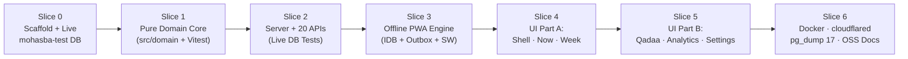

# Stage 6: Implementation Plan — Mohasba Tracker v2

**Status:** **GATE 6 APPROVED (2026-11-21)** — Authorized to Begin Stage 7 (Implementation + Continuous Verification) upon user start signal  
**Governance Mode:** Strict (Planning artifact only; zero production code or live DB migrations executed before Gate 6 Approval)  
**Last Updated:** 2026-11-21  
**Authoritative Upstream Specs:**
- [docs/00-discovery-qa.md](file:///d:/Ahmed/Projects/mohasba/docs/00-discovery-qa.md) *(Gate 1 Approved)*
- [docs/01-requirements.md](file:///d:/Ahmed/Projects/mohasba/docs/01-requirements.md) *(Gate 2 Approved)*
- [docs/02-ux-design-system.md](file:///d:/Ahmed/Projects/mohasba/docs/02-ux-design-system.md) & [docs/02b-anti-ai-slop-guide.md](file:///d:/Ahmed/Projects/mohasba/docs/02b-anti-ai-slop-guide.md) *(Gate 3 Approved — §2.1 of `02-ux-design-system.md` is the single source of truth for Dark Mode tokens)*
- [docs/03-architecture.md](file:///d:/Ahmed/Projects/mohasba/docs/03-architecture.md) *(Gate 4 Approved)*
- [docs/04-data-and-security.md](file:///d:/Ahmed/Projects/mohasba/docs/04-data-and-security.md) & [docs/04b-sql-vs-app-best-practices.md](file:///d:/Ahmed/Projects/mohasba/docs/04b-sql-vs-app-best-practices.md) *(Gate 5 Approved)*

---

## 1. Execution Strategy, Environment Isolation & Slice Definition of Done

### 1.1 Dual-Database Environment Isolation (Zero Risk to Production Data)
- **`mohasba-test` (Staging / Dev / Automated Testing — PostgreSQL 17.12):** Receives `0001_init.sql`–`0004_atomic_workspace_and_unlock.sql` and hosts ALL Stage 7 integration tests, `>1,000`-row pagination tests, concurrent `commit_sync_batch` race tests, negative SQL `CHECK` tests, and Stage 8 `.sql.gz` + JSON Restore Drills.
- **`Mohasba` (Production — PostgreSQL 17.12):** Remains **100% untouched** throughout Stages 6, 7, and 8. Only receives `0001_init.sql`–`0004_atomic_workspace_and_unlock.sql` during **Stage 9 (Release)** with explicit user deploy consent so personal daily use starts from a guaranteed clean slate.
- **Safe `mohasba-test` Reset Helper (`tests/helpers/reset-test-db.ts`):** Hard-guarded by `ALLOW_TEST_DB_RESET=true` AND explicit test-ref verification (refuses to run against `Mohasba`). Deletes test rows in strict FK order (`daily_logs → applied_mutations → reminder_dispatches → target_versions → actions → periods → unlock_rate_limits → audit_logs`) and restores default `app_settings (id = 1)`.
- **Public Repo Hygiene:** Live Supabase project refs, keys, `.env*`, `public/sw-manifest.json`, `_archive_v1_sheets/`, and server IPs are **never** committed to Git.

### 1.2 Mandatory Per-Slice Definition of Done (Test-Heavy, Zero Debt Accumulation)
Every slice follows `READ → PLAN → IMPLEMENT → VERIFY → COMMIT` and **cannot advance** until ALL of the following pass with real command output:
1. `npx tsc --noEmit` exits `0` (TypeScript strict mode).
2. `npm run lint` exits `0` (including ESLint `no-restricted-imports` layer boundaries).
3. Test runner separation cleanly passes:
   - `npm run test:unit` (`tests/domain/**`, `tests/client/**` — fast parallel Vitest)
   - `npm run test:integration` (`tests/db/**`, `tests/api/**` — sequential `--no-file-parallelism` against `mohasba-test` so shared singleton/rate-limit tables never collide!)
   - For UI slices: Playwright Desktop (`1440×900`) + Mobile (`390×844`) Light/Dark + real rendered screenshot inspection + `impeccable.cmd detect --json` (`[]`).
4. `git status` confirms zero private/ignored files or secrets are staged.

### 1.3 Hosting & YAGNI Scope Decision
- **Primary Launch Runtime:** **Oracle VPS Docker (`output: 'standalone'`, `127.0.0.1:3000`) + `cloudflared` Tunnel** in a single `docker-compose.yml` (zero inbound ports 80/443 on Oracle VCN/`iptables`, unspoofable `cf-connecting-ip`, automatic Edge HTTPS, `json-file` log rotation, native `crontab` + encrypted `pg_dump` 17 off-VPS backup). Live VPS deployment happens **only in Stage 9** with explicit consent.
- **YAGNI on Unused Cloudflare Workers Config:** The codebase remains **100% Web-Standard portable** (`src/domain/*` pure TS, Web Crypto `crypto.subtle`, standard Web `Request` parsing with zero `next/headers`, HTTP `@supabase/supabase-js`, `RuntimeConfig` injection, zero `import 'server-only'` in cron-shared modules, `output: 'standalone'`, `images: { unoptimized: true }`), **without** shipping dead/untested `wrangler.jsonc` / `custom-worker.ts` / `@opennextjs/cloudflare` adapters in MVP Slice 6. *(The `README.md` honestly describes the app as Web-Standard portable without claiming Cloudflare Workers Free was live-benchmarked in MVP.)*

---

## 2. Vertical Testable Slices (`Slice 0` → `Slice 6`)

---

### Slice 0 — Project Foundation, Boundary Lint & Live `mohasba-test` Migration
- **Dependencies:** Gate 6 Approval.
- **Files / Deliverables:**
  - Next.js (App Router, TypeScript strict) + Tailwind CSS + minimal deps (`adhan`, `idb`, `@supabase/supabase-js`, `zod`, `vitest`, `fake-indexeddb`, `@playwright/test`).
  - `package.json` scripts: `test:unit` (parallel), `test:integration` (`--no-file-parallelism`), `test:e2e`, `typecheck`, `lint`, `build`.
  - `next.config.ts`: `output: 'standalone'`, `images: { unoptimized: true }`, strict `Cache-Control: no-store, no-cache, must-revalidate` response headers on **`/sw.js`**, **`/sw-manifest.json`**, and **`/manifest.webmanifest`**.
  - Minimal PWA assets (`public/icons/icon-192.png`, `public/icons/icon-512.png`, `public/icons/apple-touch-icon.png`) + placeholder static `src/app/page.tsx` + add `public/sw-manifest.json` to `.gitignore`.
  - `eslint.config.*`: `no-restricted-imports` enforcing (a) `src/domain/*` imports zero React/Next/Supabase/DOM/Node APIs, (b) `src/client/*` never imports `src/server/*`, and (c) cron-shared `src/server/*` never imports `'server-only'`.
  - `.env.example` (6 server-only vars — `SUPABASE_URL`, `SUPABASE_SERVICE_ROLE_KEY`, `CRON_SECRET`, `APP_URL`, `APP_PASSCODE`, `NTFY_TOPIC_URL` — zero `NEXT_PUBLIC_*`) + local untracked `.env.local` pointed strictly at **`mohasba-test`**.
  - `supabase/migrations/0001_init.sql` (verbatim 9-table DDL + 2 logic-free `SECURITY INVOKER` `SET search_path = ''` RPCs + default-deny RLS + explicit `REVOKE` + explicit `GRANT ... TO service_role` from [docs/04-data-and-security.md](file:///d:/Ahmed/Projects/mohasba/docs/04-data-and-security.md) §2) + `tests/helpers/reset-test-db.ts`.
- **Mandatory Verification & Tests (Exit Criteria):**
  1. Apply `0001_init.sql` to **`mohasba-test`** via Supabase MCP `apply_migration`.
  2. Run Supabase MCP `get_advisors` (`security` + `performance`) → **0 exposed tables, 0 mutable `search_path` warnings, 0 `public` extension warnings**.
  3. Run `npm run test:integration` (`tests/db/schema-security.test.ts` against `mohasba-test`):
     - Direct PostgREST `/rest/v1/daily_logs`, `/rest/v1/audit_logs`, `/rest/v1/rpc/commit_sync_batch`, and `/rest/v1/rpc/trim_audit_logs_if_needed` using `anon` key → rejected (`401`/`403`/`42501`).
     - SQL 3-valued-logic negative constraint tests → Postgres directly rejects `(status=NULL, percent_value=50)`, `(status=NULL, qadaa_resolved_at=now())`, `(status='PERCENT', percent_value=NULL)`, `(availability_override='DISABLED', status='DONE')`, cross-action `target_version_id`, and `DELETE` on a log-referenced `target_version`.
     - `UNIQUE NULLS NOT DISTINCT` test → duplicate `(period_id=NULL, islamic_date, 'nightly_digest')` rejected.
  4. `npm run lint` + `npx tsc --noEmit` pass cleanly.

---

### Slice 1 — Pure Domain Core (`src/domain/*`) + Exhaustive Vitest Unit Suite
- **Dependencies:** Slice 0.
- **Files / Deliverables (`src/domain/*` — 100% pure TS):**
  - `types.ts`: Canonical domain types & Zod-aligned schemas.
  - `prayer-engine.ts`: `adhan` wrapper (`new Date(y, m - 1, d, 12, 0, 0)` from `iana_timezone` parts), two-pass `zonedWallClockToUtc(isoDate, hhmm, ianaTimezone)` (spring-forward gap → first valid instant after jump; fall-back overlap → earlier occurrence), 3-day sliding window `{ C - 1, C, C + 1 }`, `FAJR` & `MIDNIGHT` rollover, cross-midnight `D + 1` Fajr bound, active window resolver, Horizon Rail elapsed ratio + 25m pre-expiry flag.
  - `lifecycle.ts`: Two-layer cell availability (`availability_override ?? !default_disabled_days`), 5-state canonicalization (`100% → DONE`, `0% → MISSED`, forbidden transitions, clearing `qadaa_resolved_at` on exit), non-overwriting bulk planners (`تم ما في المسجد`, `تم الفترة بالكامل`, `يوم اعتيادي`, `ترحيل للقضاء`).
  - `qadaa.ts`: Cross-week global Qadaa queue (`<= today`), non-recoverable exclusion, historical repair attribution, original `target_version_id` lookup across target upgrades.
  - `targets.ts`: Simple Rename vs Target Evolution (`effective_from` default `D` if `EMPTY` else `D + 1`, referenced-version immutability check, active target version resolution).
  - `conflict.ts`: 3-case Fast Path (including same-device causal `parent_mutation_id` + `last_device_id`), Conflict Path (`Positive/Intentional > MISSED`, `Positive vs Positive` newer `client_updated_at` with skew clamp, independent `note_updated_at` LWW, soft-archive safety, `client_target_version_id` retention).
  - `analytics.ts`: 3 Lean Insights (Weakest Spots `<85%` + cold-start `>=5`/`>=2` + 7d/5-log `"هدف جديد"` adaptation guard + progression trail; `7d/30d` isolated `TIME_BOUND` vs `DAILY_GROUP` separating `analytics_role = 'core_jamaah'` from Sunan; Qadaa/Backlog/Core-Miss Pulse).
  - `starter-pack.ts` *(Generic Islamic Starter Pack with deterministic fixed UUIDs — zero personal habits!)* & `i18n/ar.ts`.
- **Mandatory Verification & Tests (Exit Criteria — `npm run test:unit` `tests/domain/*.test.ts`):**
  1. **Prayer/DST Suite:** Egypt spring-forward & fall-back DST dates (non-existent & repeated wall-clock times), `01:20 AM` vs `04:55 AM` Fajr rollover (`FAJR` vs `MIDNIGHT`), phone TZ != account `iana_timezone`, and cross-check of computed Cairo prayer times (+ manual offsets) against an authoritative Cairo timetable.
  2. **Lifecycle & Bulk Suite:** Non-overwrite invariants on all 4 bulk actions, `تم ما في المسجد` excluding Left-side mosque habits & `ملئ جدول المحاسبة`, `يوم اعتيادي` excluding core habits by default, `100%→DONE` / `0%→MISSED` canonicalization.
  3. **Target Evolution & Qadaa Suite:** Same-day `D` vs `D + 1` default, Cross-Upgrade Qadaa preserving Day `D`'s `10 صفحات` after upgrading to `20 صفحة`, and `"هدف جديد"` adaptation guard suppression.
  4. **Conflict Suite:** Concurrent creation (`base_row_version = null`), two-device `Positive > MISSED`, **same-device dropped-ACK self-correction (`M1: DONE → M2: MISSED` with `parent_mutation_id = M1` succeeds via Fast Path!)**, independent `note_updated_at` LWW, and offline `client_target_version_id` retention.
  5. **Analytics Suite:** Strict Right/Left isolation, `EMPTY_EXPIRED` & `DISABLED` denominator exclusion, `core_jamaah` vs Sunan split, cold-start thresholds.

---

### Slice 2 — Server Layer (`src/server/*`) + All 26 API Operations + Live `mohasba-test` Integration Suite
- **Dependencies:** Slice 0, Slice 1.
- **Files / Deliverables:**
  - `src/server/config.ts` (`RuntimeConfig`), `db/supabase.ts`, `db/pagination.ts` (Keyset Paginator on `(log_date ASC, action_id ASC)`, page size `1,000`), `observability/logger.ts` (`stdout` JSON + `sanitizeAuditContext` stripping secrets AND raw `note` text + `<= 2 KB` context / `<= 1.5 KB` stack + fail-safe non-blocking `audit_logs` writer).
  - `src/server/access/guard.ts`: Accepts standard **Web `Request`** directly (reads `cookie`/`origin`/`sec-fetch-site`/`cf-connecting-ip`/`authorization` with **zero `next/headers`** so Vitest calls Route Handlers directly via `new Request(...)` AND `workerd` portability holds!). Implements fail-closed `503 SETUP_INCOMPLETE`, Web Crypto `HKDF(CRON_SECRET + ":" + APP_PASSCODE, "mohasba-session-v1")` 180-day `HttpOnly; SameSite=Lax` cookie, per-IP hashed `unlock_rate_limits` (`ipSalt = HKDF(CRON_SECRET, "mohasba-ip-salt-v1")`, skips shared bucket when IP header absent in local dev), `Origin`/`Sec-Fetch-Site` + `application/json` CSRF guard, constant-time `CRON_SECRET` verifier.
  - `src/server/services/*`:
    - `bootstrap-service.ts`: Full 90d + all open Qadaa (`>90d` included) via keyset pagination; delta mode with `since - 5 minutes` overlap; resumable `initStarterPack` guarded strictly by `!settings.onboarding_completed`.
    - `sync-service.ts`: 2–4 bulk reads → **sequential intra-batch resolution against an in-memory working `currentRows[cell_key]` map** (skipping `row_version` bump for `already_applied` IDs, advancing `expected_row_version` + `last_mutation_id` after each non-duplicate item so `[M1, M2]` for the same cell in ONE batch never self-collides on `MC001`!) → `commit_sync_batch` passing server-read `expected_row_version`, retrying any `race_conflict` row once after fresh re-read.
    - `crud-service.ts`: Settings, Periods, Actions soft-archive/restore + open-Qadaa warning count when toggling `is_qadaa_eligible` off, Target Versions `POST/PATCH/DELETE` (`409` on referenced version), per-row `.update()` `reorder` (`<= 300` items).
    - `export-import-service.ts`: Complete keyset-paginated `GET /api/export` + chunked (`<= 200` logs/req) `POST /api/import` (`target_versions` UUID/`effective_from` matching, cross-action validation, `Positive > MISSED` merge without polluting `applied_mutations`).
    - `ntfy-dispatcher.ts`: `runCronTick` keep-alive + daily prune guarded by `last_pruned_date` (`applied_mutations > 90d`, `reminder_dispatches > 90d`, expired `unlock_rate_limits`, `trim_audit_logs_if_needed`) + biweekly backup nudge + `triggerInstant <= now < endInstant` anti-flood bound + `Promise.allSettled` 5s timeout + `APP_URL` deep links + `test-ntfy`.
  - All 22 Next.js `force-dynamic` Route Handlers (`src/app/api/**`) covering all 26 active operations in [docs/04-data-and-security.md](file:///d:/Ahmed/Projects/mohasba/docs/04-data-and-security.md) §3.
- **Mandatory Verification & Tests (Exit Criteria — `npm run test:integration` `tests/api/*.test.ts` against `mohasba-test`):**
  1. **RPC Concurrency, Intra-Batch Chaining & Poison Isolation:**
     - Simultaneous `expected_row_version = null` inserts → 1 `applied`, 1 `race_conflict` (resolved via retry, zero lost updates).
     - Simultaneous duplicate `mutation_id` → 1 `applied`, 1 `already_applied`.
     - **Same-cell `[M1, M2]` in ONE batch** + cross-request dropped-ACK `M1 (DONE) → M2 (MISSED, parent=M1)` (verifying same-device `MISSED` wins via causal Fast Path while different-device `MISSED` loses via Conflict Path!).
     - 50-item batch with 1 poison item (`check_violation` & `22007` invalid date) → 1 `rejected`, 49 `applied`.
     - Soft-archived action replay (`log_date <= archived_at`) + `client_target_version_id` retention across target upgrades.
  2. **RPC #2 (`trim_audit_logs_if_needed`):** Live test verifying 7-day protection floor (recent rows never deleted) + threshold trim (`p_max_rows` exceeded deletes oldest batch cleanly).
  3. **>1,000-Row Keyset Pagination, Bootstrap & Chunked Import:** Seed `1,250` `daily_logs` rows (including `>90d` open Qadaa + mid-read insert) → verify `GET /api/bootstrap` (full + `?since=` 5m overlap), `GET /api/logs`, and `GET /api/export` return complete results; verify `POST /api/import` merges cleanly and rejects cross-action target refs.
  4. **CRUD, Resumable Starter Pack & Per-Row Reorder:** Simulated partial seed (`actions > 0, onboarding_completed = false`) retries cleanly; `PATCH`/`DELETE /api/target-versions/[id]` returns `200` unreferenced & `409` referenced; `POST /api/schema/reorder` updates `periods` and `actions` without `NOT NULL` errors.
  5. **Auth, CSRF, Privacy & Cron:** Fail-closed `503`; `POST /api/unlock` → cookie → `POST /api/logout` → `401 UNLOCK_REQUIRED` round-trip; per-IP `429` lockout (does not lock 2nd IP); cross-origin `403`; `GET /api/cron/tick` → `405`; `POST /api/cron/tick` idempotent dispatch cap + anti-flood bound; zero-secret / zero-raw-`note` assertions on `GET /api/export` & `audit_logs`.

---

### Slice 3 — Offline-First PWA Engine (`src/client/*` + `public/sw.js` + Precache Manifest)
- **Dependencies:** Slice 1, Slice 2.
- **Files / Deliverables:**
  - `src/client/db/idb.ts`: Thin `idb` wrapper over 4 stores (`snapshot`, `logs`, `outbox`, `meta`) + `wipeAllLocalData()` for Sign Out.
  - `src/client/sync/outbox-engine.ts`: `<50ms` atomic IDB writes, 5s Undo (`hold_until` persisted in IDB, no `pagehide` `keepalive`), coalescing ONLY when `attempt_count === 0`, immutable frozen `mutation_id` once dispatched + causal `parent_mutation_id`, stale-ACK protection, cross-tab `navigator.locks` + `BroadcastChannel('mohasba-sync')`, deadlock-free Drain-Before-CRUD (waits for `held | pending | in_flight === 0`, excludes `attention_needed`), dirty-cell skip during `/api/bootstrap` merge, `>90d` lazy fetch via `/api/logs`, 100% client-side offline Snapshot & Emergency Outbox JSON Export, 4-state Sync Badge store.
  - `src/client/store/mohasba-provider.tsx`: Immediate IDB hydration on mount (`<50ms`), memoized `src/domain/*` selectors, `POST /api/logout` flow (unsynced warning + Emergency Export → cookie clear → `wipeAllLocalData()`).
  - `scripts/generate-sw-manifest.mjs` (~15-line post-build script wired into `"build": "next build && node scripts/generate-sw-manifest.mjs"`, normalizing all paths to POSIX `/`, filtering out `*.map`, including `/`, `/_next/static/*` JS/CSS + `/_next/static/media/*` `Readex Pro` `.woff2`, and `public/icons/*` tagged with `buildId`) + `public/sw.js` (~120 lines, atomic `mohasba-shell-<buildId>` `cache.addAll()`, `/api/*` & `RSC` strictly `NetworkOnly`, query-ignoring `/` fallback for `ntfy` deep links, safe non-interrupting update activation) + `public/manifest.webmanifest` + `src/client/pwa/register-sw.ts` (iOS `!standalone` A2HS prompt, `navigator.storage.persist()`).
- **Mandatory Verification & Tests (Exit Criteria):**
  1. **Vitest + `fake-indexeddb` (`tests/client/*.test.ts`):** `<50ms` optimistic tap & bulk batch Undo (`batch_id`) with 0 network calls; app-close inside 5s Undo recovery (`hold_until` expiry); dropped-ACK `M1 → M2` frozen ID + `parent_mutation_id` + stale-ACK protection; deadlock-free Drain-Before-CRUD with 1 `attention_needed` item present; dirty-cell protection during bootstrap merge.
  2. **Playwright SW Harness (`next build && next start` on minimal `/` harness):** Verifies atomic `cache.addAll()` with `0` 404s, `/api/*` stays `NetworkOnly`, offline reload of `/` and `/?period=asr&date=2026-11-21` succeeds from cache, and `POST /api/logout` wipes all 4 IndexedDB stores. *(Full 5-view offline tab-switching & `0 ChunkLoadError` verification executes in Slices 4 & 5 once the 5 views exist.)*

---

### Slice 4 — Production UI Part A: Statically Prerendered Single App Shell + `الآن (Street Mode)` + `الجدول الأسبوعي`
- **Dependencies:** Slice 3.
- **Files / Deliverables:**
  - Run `impeccable context` once before styling; author `src/app/globals.css` with exact *Al-Mizan Al-Ma'dani* tokens from **[docs/02-ux-design-system.md](file:///d:/Ahmed/Projects/mohasba/docs/02-ux-design-system.md) §2.1** (Light `#F3F5F6`/`#FFFFFF`/`#0F5257`; Dark Dimmed Graphite `#16181C`/`#1D2026`/`#58A4AA`/`#1E5B60` — authoritative over older hex notes in `02b`), `Readex Pro` (`next/font`), `tabular-nums`, RTL logical CSS only, zero resting shadows, uniform `1.5px` SVG icon set, zero music/audio, zero AI-slop tells ([docs/02b-anti-ai-slop-guide.md](file:///d:/Ahmed/Projects/mohasba/docs/02b-anti-ai-slop-guide.md)).
  - Statically prerendered `src/app/layout.tsx` (including blocking inline anti-FOUC theme `<script>` to prevent daylight flash at Fajr!) & `src/app/page.tsx` (zero server `cookies()`/`headers()`/`searchParams`; **do NOT use Next `useSearchParams()`** — read `?view=&period=&date=` via `window.location.search` in `useEffect` + `popstate` and update via `history.pushState`/`replaceState`; all views eagerly bundled with zero `next/dynamic` on core offline screens).
  - Shell chrome enforcing **Gate 3 §6 Condition #3**: **single icon-only Dark/Light toggle permanently in the top-left of the top bar** on both Desktop & Mobile, collapsible Desktop RTL sidebar with layout-independent physical shortcut **`Ctrl + KeyI`** (`Ctrl+I` / `Ctrl+ه` tooltip), 4-state Sync Badge, inline Passcode Unlock Gate (`Mode B`) & First-Run Onboarding (`Starter Pack` / `Import JSON` / `Start Blank`).
  - **`الآن (Street Mode)`:** 7-day strip, active window header with **`2px` Time-Window Horizon Rail** (Aegean Petrol → Harvest Ochre in final 25m), conditional 48h Catch-Up banner navigating to `?view=qadaa&tab=catchup`, non-overwriting split buttons (`تم ما في المسجد` / `تم الفترة بالكامل`), WHOOP-style rows (`target_label`, 7-day dots, `44px+` inline `✓/✕`, `25/50/75/100/0%` chips, `•••` excuse/note modal), window-bound left-side sub-list, live 5s Undo toast.
  - **`الجدول الأسبوعي (Weekly Matrix)` + Cell Editor `<dialog>`:** Desktop Standard Mode + **One-Glance Zero-Scroll Side-by-Side Mode** enforcing **Gate 3 §6 Conditions #1 & #2** (strong distinct period/group dividers + breathable `25–26px` rows & `12.5px` readable Arabic labels), `يوم اعتيادي` & `ترحيل للقضاء` bulk actions, lazy week navigation (`>90d`), Mobile WHOOP 7-day boxes with crisp English `Sat..Fri` labels, and full **Cell Editor `<dialog>`** (`10%` percentage steps, toggling default-off cells via `ENABLED` override, disabling already-logged cells with confirmation or 5s Undo, `QADAA_DONE`, `note`, and read-only historical `target_label` snapshot).
- **Mandatory Verification & Tests (Exit Criteria):**
  1. `npm run build` confirms `/` is statically prerendered as **`○ (Static)`** with `0` build warnings/errors.
  2. `impeccable.cmd detect --json src/app src/client` → **`[]`** (0 AI-slop / craft-floor violations).
  3. Playwright visual & DOM verification + real rendered screenshot review on Desktop (`1440×900` Light & Dark, Standard + One-Glance `overflowX: false`, zero-scroll check, `Ctrl+KeyI` Arabic/English check) and Mobile (`390×844` Light & Dark, `44px+` touch targets, `overflowX: false`, 0 console errors).
  4. End-to-end tap → 5s Undo → sync → offline reload (`next start`) persistence test against `mohasba-test` with `0 ChunkLoadError`s.

---

### Slice 5 — Production UI Part B: `القضاء` + `التحليلات` + `الإعدادات`
- **Dependencies:** Slice 4.
- **Files / Deliverables:**
  - **`القضاء` (`Qadaa & 48h Backlog`):** Segmented tabs (`عليّ قضاؤه` showing Day `D`'s original historical `target_label` with 1-tap `تم القضاء`, `استدراك غير مسجّل (48 ساعة)` wired to `?view=qadaa&tab=catchup`, `فوات لا يُقضى`).
  - **`التحليلات` (`3 Lean Weakness Insights`):** (1) Top Weakest Spots (`<85%`, `"هدف جديد"` adaptation guard badge, inline progression trail `10 صفحات ← 20 صفحة`), (2) `7d / 30d` isolated `TIME_BOUND` vs `DAILY_GROUP` breakdown separating `الجماعة الأولى` from Sunan, (3) Qadaa Velocity, Anti-`مراكمة` Logging Coverage, and Non-Recoverable Core Misses.
  - **`الإعدادات` (`Online-Only CRUD, تطوير الهدف, ntfy, Backup & Audit Logs`):** Online-only guard banner (powered by deadlock-free Drain-Before-CRUD), Period CRUD + full **Action Form** (`bound_time_period_id`, `default_disabled_days`, `include_in_normal_day_preset`, `is_mosque_action`, `is_qadaa_eligible` with live open-Qadaa count warning when turning `true → false`, `supports_percentage`, `analytics_role`), explicit **Simple Rename (`تعديل الاسم فقط`)** vs **`تطوير الهدف` modal** (`today D` vs `tomorrow D + 1` default + edit/delete unreferenced versions), drag/button reorder (`POST /api/schema/reorder`), soft-archive/restore, `FAJR`/`MIDNIGHT` + `week_start_day` + city/coordinates/offsets config, rich per-period **`ntfy`** customization + Quiet Hours + Nightly Digest + `backup_reminder_enabled` + `تجربة التنبيه` (`POST /api/settings/test-ntfy`), Online Full Export / Offline Emergency Export / Chunked JSON Import, compact read-only **`آخر الأحداث والأخطاء`** drawer (`GET /api/audit-logs`), Sync Attention popover (`Retry` / `Export+Discard` / `Discard`), iOS A2HS notice, and Sign Out (`POST /api/logout` + unsynced warning + IDB wipe).
- **Mandatory Verification & Tests (Exit Criteria):**
  1. `impeccable.cmd detect --json src/app src/client` → **`[]`**.
  2. Playwright E2E + real rendered screenshot inspection across all 5 views on Desktop (`1440×900`) & Mobile (`390×844`), Light & Dark (0 console errors, `overflowX: false`, full offline 5-view tab switching with `0 ChunkLoadError`s), exercising Target Evolution (`D+1` default & Cross-Upgrade Qadaa target preservation), `is_qadaa_eligible` warning, `ntfy` Settings + test button, Export/Import round-trip, and Sync Attention recovery.

---

### Slice 6 — Oracle VPS Docker, `cloudflared` Tunnel, Encrypted `pg_dump` 17 Backup & OSS Packaging (Local Prep)
- **Dependencies:** Slice 5.
- **Files / Deliverables (Local Repo Only — Live VPS Deploy Waits for Stage 9):**
  - `Dockerfile`: 3-stage `node:22-alpine` (`deps → builder → non-root runner`, `output: 'standalone'`), explicitly copying **`.next/standalone`**, **`.next/static`**, and **`public/`** (including build-generated `public/sw-manifest.json`), setting `ENV HOSTNAME="0.0.0.0" PORT=3000`, requiring **zero build-time secrets**, and using **Node 22 built-in `fetch`** for healthcheck (`["CMD","node","-e","fetch('http://127.0.0.1:3000/api/health').then(r=>process.exit(r.ok?0:1)).catch(()=>process.exit(1))"]` — no `curl` dependency on Alpine!).
  - `docker-compose.yml`: Two lean services on an internal bridge network:
    - `mohasba` (`ports: ["127.0.0.1:3000:3000"]`, `restart: unless-stopped`, `logging: json-file max-size: 20m max-file: 3`).
    - `cloudflared` (`profiles: ["tunnel"]` so local `docker compose up mohasba` tests cleanly without a tunnel token; `cloudflare/cloudflared:latest`, `restart: unless-stopped`, `mem_limit: 128m`, `logging: json-file max-size: 20m max-file: 3`, forwarding custom domain → `http://mohasba:3000`, zero open inbound ports 80/443).
  - `scripts/backup-supabase.sh`: Production-hardened weekly backup script (`set -euo pipefail`, checks `pg_dump` major version `>= 17`, sources `SUPABASE_DB_BACKUP_URL` — explicitly documenting Supabase **Session Pooler URI on port `5432`, IPv4-safe**, never Transaction Pooler `6543` — from `chmod 600` `/srv/mohasba/.backup.env`, dumps to temp file, validates `gzip -t` + non-zero size BEFORE promoting/rotating, encrypts via `age` public key or `rclone crypt` before off-VPS upload to Cloudflare R2 Free / Google Drive, rotates last 12 dated snapshots).
  - `deploy/crontab.example`: 10-minute `ntfy`/keep-alive tick (sourcing `chmod 600` `.env`, `POST http://127.0.0.1:3000/api/cron/tick`) + weekly `backup-supabase.sh`.
  - Clean Open-Source `README.md` (5-minute setup, Oracle VPS + `cloudflared` guide, **Oracle PAYG + `$1` budget-alert** idle-reclamation tip, Supabase dashboard setup checklist, honest note that codebase is Web-Standard portable without claiming Cloudflare Workers Free was live-benchmarked in MVP) & `LICENSE` (MIT).
- **Mandatory Verification & Tests (Exit Criteria):**
  1. Local `docker build` succeeds cleanly with zero build-time secrets; `docker compose up -d mohasba` boots to `healthy` status and `GET http://127.0.0.1:3000/api/health` returns `200 { ok: true }` against `mohasba-test` (and `/sw-manifest.json` returns `200` with `Cache-Control: no-store`).
  2. `bash -n scripts/backup-supabase.sh` passes syntax check; dry-run test confirms `set -euo pipefail` fails cleanly on invalid URI (never creating an empty `.sql.gz`).
  3. Full public-repo hygiene scan confirms zero secrets, zero personal emails/IPs, zero `_archive_v1_sheets/` references in tracked files.

---

## 3. Handoff to Stage 8 (Integrated Quality Verification) & Stage 9 (Release)

- **Stage 8 (Integrated Release Verification — on `mohasba-test`):**
  1. Real-device **Phone Airplane Mode vs Online PC** sync conflict test (including dropped-ACK `M1 → M2` self-correction & mid-offline deploy SW update check).
  2. **Dual Restore Drill on `mohasba-test`:**
     - **(a) `.sql.gz` Restore:** Drop **only** the 9 app tables + 2 RPCs on `mohasba-test` (**NEVER** `DROP SCHEMA public CASCADE`, which breaks Supabase schema grants!), restore a verified `pg_dump` `.sql.gz` archive, and re-run `supabase_mcp:get_advisors` (`0` warnings).
     - **(b) `>1,000`-Row JSON Restore:** Reset `mohasba-test` via `reset-test-db.ts`, import a full `1,250+`-row `GET /api/export` JSON snapshot, and assert exact parity of `periods`, `actions`, `target_versions`, `daily_logs`, and open Qadaa count.
  3. Final full regression run (`tsc`, `lint`, `test:unit`, `test:integration`, `playwright`, `impeccable detect`, `supabase advisors`, `anon` penetration check, fresh-clone OSS build check, optional `DESIGN.md` capture via `impeccable document`).
- **Stage 9 (Production Release — Explicit User Deploy Consent Required):**
  1. Apply `0001_init.sql` through `0004_atomic_workspace_and_unlock.sql` in exact numerical order to clean Production **`Mohasba`** Supabase project + verify `get_advisors` clean.
  2. Deploy `docker-compose.yml` (`mohasba` + `cloudflared` Tunnel bound to custom domain via `--profile tunnel`), install `postgresql-client-17` + `crontab` + encrypted weekly off-VPS backup on Oracle VPS.
  3. Verify live HTTPS custom domain, `ntfy` test push + deep link on phone, and PWA installability (iOS/Android).
